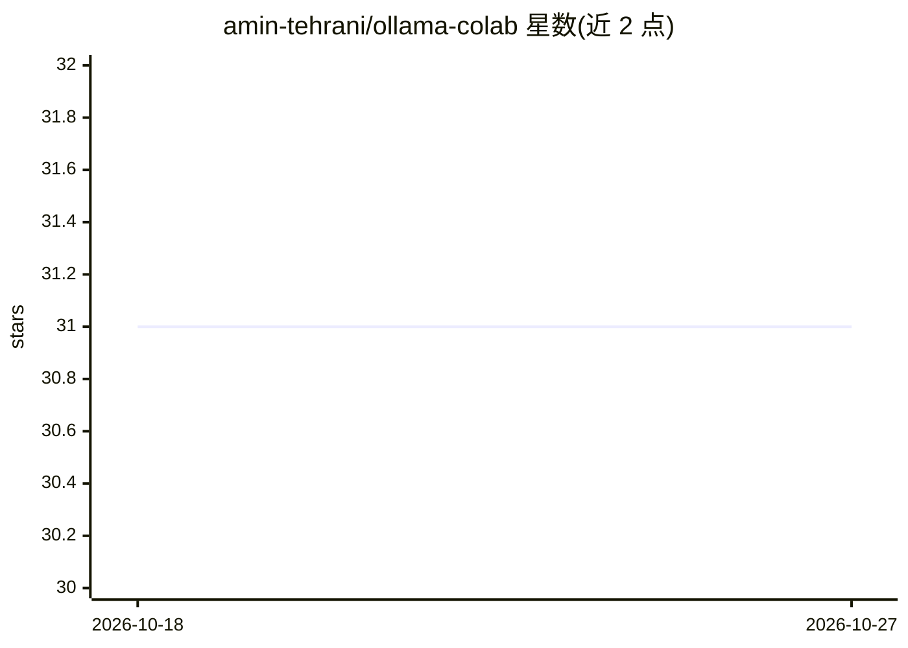

# amin-tehrani/ollama-colab

⭐ 31 · Jupyter Notebook · MIT · 推送 2026-05-12 · [GitHub](https://github.com/amin-tehrani/ollama-colab) · 个人维护

**在 Google Colab 免费 GPU 上运行 Ollama 并经 Ngrok 暴露公网 API**

一个 Jupyter Notebook：在 Google Colab 免费 T4/A100 GPU 上启动 Ollama 服务（端口 11434），通过 Ngrok 隧道暴露为公网 REST API 端点。Ollama API 兼容 OpenAI 接口，curl、LangChain、OpenAI 客户端可直接调用。默认拉取 llama3，可替换为 ollama.com/library 中的任意模型。需要 Google 账号与 Ngrok 账号（免费层即可）。限制：Colab 免费会话约 12 小时闲置超时，每次会话仅一个公网 URL，模型权重每次会话重新下载（除非挂载 Google Drive）。

## 筛选速览

| 维度 | 判定 | 备注 |
|---|---|---|
| AI 角色 | `ai-ecosystem` | LLM/agent 周边工具 |
| 许可风险 | `permissive` | MIT |
| 部署形态 | `None` |  |
| 模型依赖 | local-ok | 支持本地模型 |
| 硬件要求 | — | 无带数字的原话,不猜 |
| 安装摩擦 | `low` | 无编译、无系统依赖或容器化 |
| 成熟度 | — | 结构信号不足 |

## 能力要点

- 在 Colab 免费 GPU 上运行 Ollama 并暴露 OpenAI 兼容 API
- Ngrok 隧道生成公网端点，curl/LangChain/OpenAI 客户端可直接调用
- 支持替换为 ollama.com/library 任意模型（llama3/mistral/gemma2/phi3 等）

## 适用场景

- 没有本地 GPU 时免费跑 LLM 推理
- 为脚本或应用临时获取一个公网可访问的 LLM API 端点
- 快速试用 Ollama 上的不同开源模型

## 场景标签

`推理引擎` · 领域:训练与推理

## 证据(README 行号)

> L3: > Run Ollama LLMs on Google Colab's free GPU — exposed as a public API endpoint via Ngrok.
> L17:   └─ Ollama server  (:11434)
> L21: Ollama's API is OpenAI-compatible, so any client that speaks OpenAI can point at this endpoint with zero changes.

## 星数曲线

2026-10-18 31 → 2026-10-27 31（+0）

---
*卡片 v1 · prompt 1.4 · 生成 2026-10-26 · 置信度 high · 依据 README sha `bed8632a26d5` · [字段定义](../../DATASET.md)*
