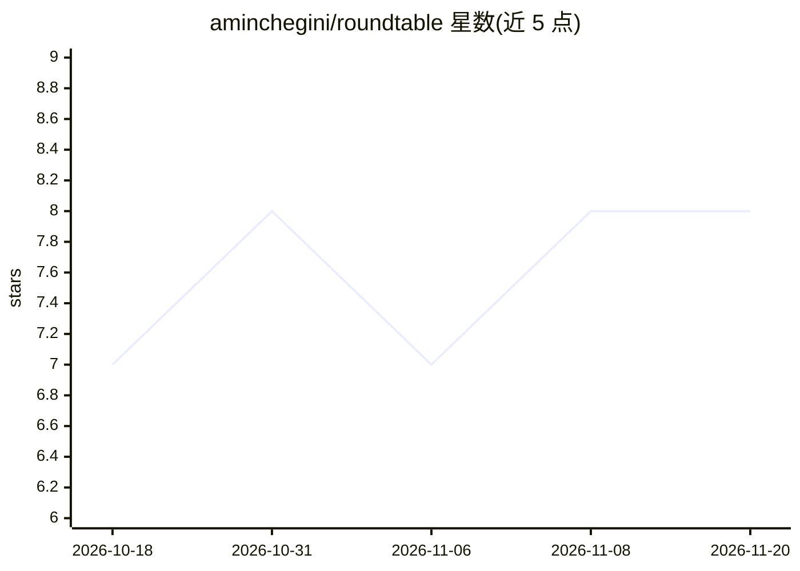

# aminchegini/roundtable

⭐ 8 · TypeScript · MIT · 推送 2026-10-07 · [GitHub](https://github.com/aminchegini/roundtable) · [官网](https://github.com/aminchegini/roundtable#readme) · 个人维护

**在 VS Code 中让多个 AI 编码代理同房间辩论协作的扩展**

VS Code 扩展，将 Claude Code、Codex、Gemini CLI、GitHub Copilot、Cursor 五家厂商的命令行代理组织进同一界面：支持群聊房间与私聊 DM、@点名发言、回合/预算/配额/token 上限、暂停/跳过控制、Build/Plan/Ask 模式，以及 shell 安全、路径保护、typecheck/lint/test 门槛等护栏（solo/team/factory 预设）。本身约 1 MB、不带 AI 运行时，驱动用户已安装并登录的厂商 CLI，使用既有订阅，无遥测。0.4.x 为 pre-release；Gemini 与 Cursor 适配器标注实验性。

## 筛选速览

| 维度 | 判定 | 备注 |
|---|---|---|
| AI 角色 | `ai-ecosystem` | LLM/agent 周边工具 |
| 许可风险 | `permissive` | MIT |
| 部署形态 | `library` | 以包/库形式分发 |
| 模型依赖 | locked-api |  |
| 硬件要求 | — | 无带数字的原话,不猜 |
| 安装摩擦 | `low` | 无编译、无系统依赖或容器化 |
| 成熟度 | `idea` | |

## 能力要点

- 五家厂商 CLI 代理同房间辩论，@点名发言、pass 机制与轮次上限
- 护栏预设 solo/team/factory：shell 安全、secrets 扫描、typecheck/lint/test 门槛、reviewer veto
- 每个 (room, agent) 对独立会话，跨重启恢复
- 无遥测，仅产生厂商自身 CLI 的网络流量

## 适用场景

- 让多个已订阅的编码代理互相评审同一个设计或实现
- 为团队统一配置项目级护栏并入库共享
- 在 VS Code 侧边栏直接与某个代理私聊处理任务

## 场景标签

`多智能体` `编码 Agent` · 领域:Agent 开发

## 证据(README 行号)

> L5:  Several AI coding agents in one room inside VS Code — from the vendors you already pay for, on your machine, under 
> L58: Roundtable is ~1 MB and ships **no AI runtimes**. It drives the vendor command-line agents you already have, with t
> L39: - **Five vendors, your logins.** Claude (Claude Code), OpenAI Codex (ChatGPT), Google Gemini (Gemini CLI), GitHub C

## 星数曲线

2026-10-18 7 → 2026-11-20 8（+1）

---
*卡片 v1 · prompt 1.4 · 生成 2026-11-20 · 置信度 mid · 依据 README sha `143f1cabea1b` · [字段定义](../../DATASET.md)*
