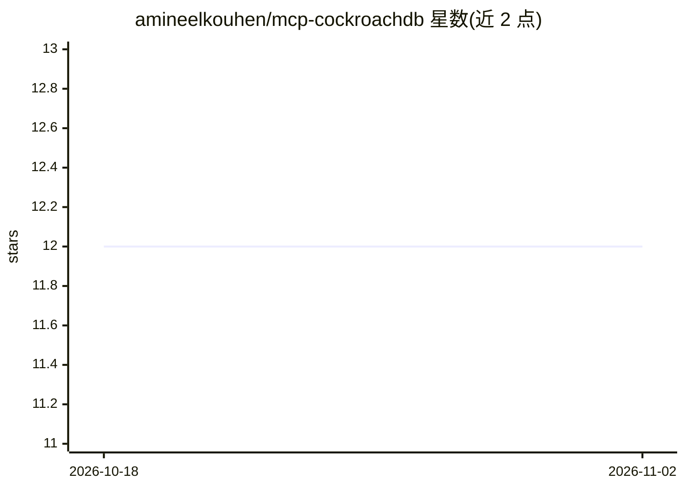

# amineelkouhen/mcp-cockroachdb

⭐ 12 · Python · MIT · 推送 2026-07-16 · [GitHub](https://github.com/amineelkouhen/mcp-cockroachdb) · 个人维护

**让 LLM/Agent 用自然语言管理 CockroachDB 的 MCP 服务器**

面向 LLM 与 agentic 应用的 CockroachDB MCP 服务器：将数据库操作暴露为 13 类 MCP 工具，覆盖自然语言查询与事务、集群监控、表与索引管理、用户权限、向量相似度检索（C-SPANN 索引）、任务管理、备份恢复（s3/gs/azure/nodelocal）、多区域配置、CDC changefeeds 与诊断。通过 asyncpg 连接池访问数据库，支持 stdio 与 streamable HTTP 传输，可与 Claude Desktop、Cursor 等 MCP 客户端配合。设有安全层：严格标识符校验、参数化查询、--read-only 模式、破坏性操作需显式确认。安装途径包括 uvx 直接运行、git clone、Docker 与 MCPB bundle。

## 筛选速览

| 维度 | 判定 | 备注 |
|---|---|---|
| AI 角色 | `ai-ecosystem` | LLM/agent 周边工具 |
| 许可风险 | `permissive` | MIT |
| 部署形态 | `self-host` | docker 或自建部署 |
| 模型依赖 | — | README 未给出锁定关系 |
| 硬件要求 | — | 无带数字的原话,不猜 |
| 安装摩擦 | `low` | 无编译、无系统依赖或容器化 |
| 成熟度 | — | 结构信号不足 |

## 能力要点

- 13 类 MCP 工具覆盖查询、监控、表管理、备份、CDC、多区域等 CockroachDB 能力
- 向量相似度检索（cosine/L2/ip）与 C-SPANN ANN 索引管理（v25.2+）
- 安全模型：--read-only 模式、破坏性操作需 --allow-destructive 加 confirm=True
- 支持 stdio 与 streamable HTTP 两种传输，兼容任意 MCP 客户端

## 适用场景

- 在 Claude Desktop 或 Cursor 中通过对话查询和管理 CockroachDB
- 让运维 agent 监控集群健康、慢查询与复制状态
- 通过 agent 执行备份恢复、changefeed 与多区域配置任务
- 为 RAG 应用在 CockroachDB 中执行向量相似度检索

## 场景标签

`数据分析` · 领域:效率与自动化

## 证据(README 行号)

> L11: The CockroachDB MCP Server is a **natural language interface** designed for LLMs and agentic applications to manage
> L31: - **Seamless MCP Integration**: Works with any MCP client (Claude Desktop, Cursor, VS Code Copilot, OpenAI Agents S
> L36: The CockroachDB MCP Server exposes CockroachDB as a set of MCP tools. Requests flow from any MCP client through a t

## 星数曲线

2026-10-18 12 → 2026-11-02 12（+0）

---
*卡片 v1 · prompt 1.4 · 生成 2026-11-01 · 置信度 mid · 依据 README sha `b26b3d9d4d67` · [字段定义](../../DATASET.md)*
