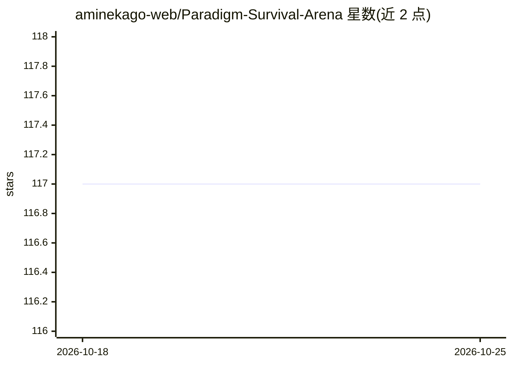

# aminekago-web/Paradigm-Survival-Arena

⭐ 117 · HTML · 推送 2026-10-24 · [GitHub](https://github.com/aminekago-web/Paradigm-Survival-Arena) · 个人维护

**六种机器学习范式在浏览器生存竞技场中对抗演化**

基于 Python 训练、浏览器可视化的 AI 演化竞技场：六种学习范式（强化学习、监督、自监督、半监督、演化策略、无监督）各以随机初始化神经网络参与持续生存模拟，经过探索、冲突、选择、跨范式迁移与变异等阶段，每 100 代决出优势范式。浏览器查看器提供神经活动热图、谱系树、范式性能面板与回放导出等功能，并声明可用于元学习、涌现行为与迁移学习等研究。代码以 MIT 许可开源，仓库结构仅部分展示，README 未给出安装运行命令。

## 筛选速览

| 维度 | 判定 | 备注 |
|---|---|---|
| AI 角色 | `ai-ecosystem` | LLM/agent 周边工具 |
| 许可风险 | `none` | — |
| 部署形态 | `None` |  |
| 模型依赖 | — | README 未给出锁定关系 |
| 硬件要求 | — | 无带数字的原话,不猜 |
| 安装摩擦 | `medium` | 含编译或系统依赖之一 |
| 成熟度 | — | 结构信号不足 |

## 能力要点

- 六种学习范式同场竞争的浏览器生存模拟
- 跨范式知识迁移与谱系追踪
- WebGL/WebAssembly 实时可视化：神经热图、谱系树、回放与权重导出
- 每代由七个动态环境参数驱动，竞技场定期重置

## 适用场景

- 观察不同学习范式在竞争环境下的适应与涌现行为
- 研究跨架构迁移学习与演化动力学
- 通过竞技场观察学习机器学习概念

## 场景标签

 · 领域:AI 模拟/教育研究

## 证据(README 行号)

> L5: **Six machine-learning paradigms — RL, supervised, self-supervised, semi-supervised, evolutionary, and unsupervised 
> L95: Synaptic Colosseum serves multiple research purposes:
> L97: - **Meta-Learning Studies**: Observe how different paradigms learn to learn across changing environments

## 星数曲线

2026-10-18 117 → 2026-10-25 117（+0）

---
*卡片 v1 · prompt 1.4 · 生成 2026-10-23 · 置信度 mid · 依据 README sha `9da1a986122f` · [字段定义](../../DATASET.md)*
