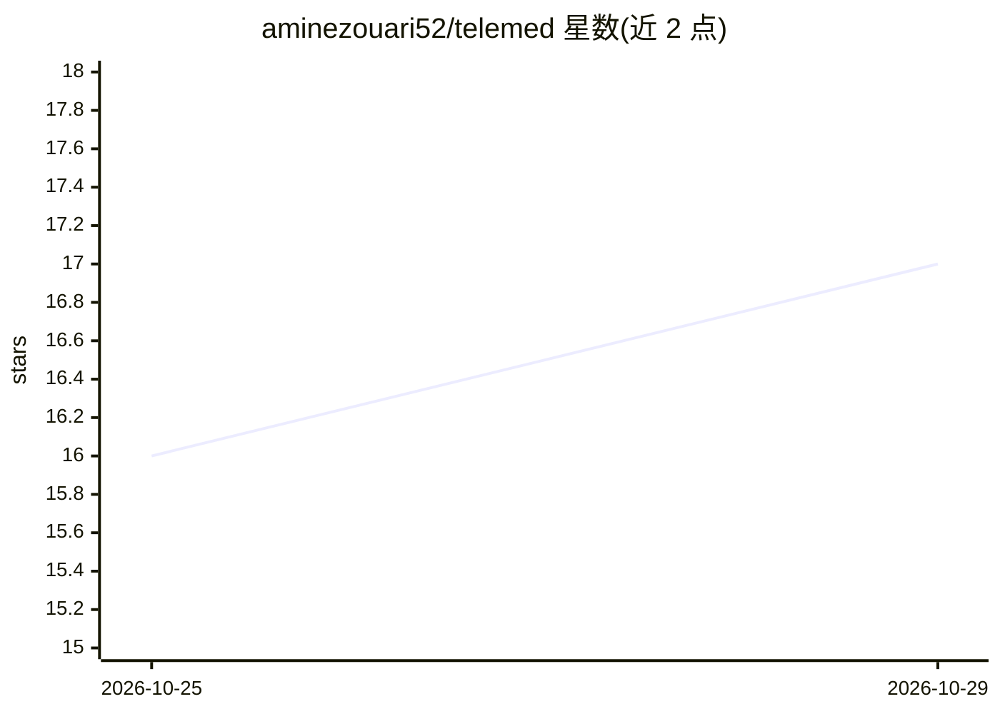

# aminezouari52/telemed

⭐ 17 · JavaScript · MIT · 推送 2026-10-24 · [GitHub](https://github.com/aminezouari52/telemed) · [官网](https://telemed-demo.netlify.app) · 个人维护

**开源远程医疗应用模板：视频问诊、预约支付与 AI 健康助手**

可改造品牌后直接构建产品的远程医疗样板应用：患者端支持按姓名/科室/医院搜索医生、Stripe 支付预约时段、LiveKit 视频音频聊天问诊、仪表盘与历史记录；医生端含资料注册与管理员审核；另含 AI 健康助手，可读取上传的 PDF 和图片，回答症状、化验、用药等问题。技术栈为 Next.js + Express + MongoDB + Clerk + LiveKit + Stripe，AI 部分通过 Gemini、Vercel AI SDK、LangChain 与 MongoDB Atlas Vector Search 实现。需 Node.js 20+、pnpm 8 与 MongoDB Atlas、Clerk 账号；Stripe/LiveKit/Gemini 等为可选服务，加入各自 key 后启用对应功能。

## 筛选速览

| 维度 | 判定 | 备注 |
|---|---|---|
| AI 角色 | `ai-enhanced` | 去掉 AI 部分产品仍成立 |
| 许可风险 | `permissive` | MIT |
| 部署形态 | `library` | 以包/库形式分发 |
| 模型依赖 | — | README 未给出锁定关系 |
| 硬件要求 | — | 无带数字的原话,不猜 |
| 安装摩擦 | `low` | 无编译、无系统依赖或容器化 |
| 成熟度 | — | 结构信号不足 |

## 能力要点

- 患者搜索医生、Stripe 支付预约、LiveKit 视频问诊（含音视频与聊天）
- AI 助手读取上传 PDF/图片，回答症状、化验、用药与生命体征问题
- 医生注册与资料填写需管理员审核，平台含患者记录管理
- Stripe/LiveKit/Cloudinary/Gemini 均为可选服务，加 key 启用对应功能

## 适用场景

- 基于模板快速搭建自有品牌的远程问诊产品
- 让患者向 AI 助手咨询症状、化验结果与用药问题
- 学习 Next.js + Express + LiveKit + Stripe 的全栈问诊支付流程

## 场景标签

`文档问答` · 领域:知识与检索

## 证据(README 行号)

> L7: An open-source telemedicine boilerplate: a working telehealth app you can rebrand and build your product on.
> L24: - Ask the AI assistant about symptoms, lab results, medications and vital signs. It can read uploaded PDFs and imag
> L79: You need Node.js 20 or later, pnpm 8, and free accounts with MongoDB Atlas and Clerk. Stripe, LiveKit, Cloudinary a

## 星数曲线

2026-10-25 16 → 2026-10-29 17（+1）

---
*卡片 v1 · prompt 1.4 · 生成 2026-10-29 · 置信度 high · 依据 README sha `06255b007856` · [字段定义](../../DATASET.md)*
