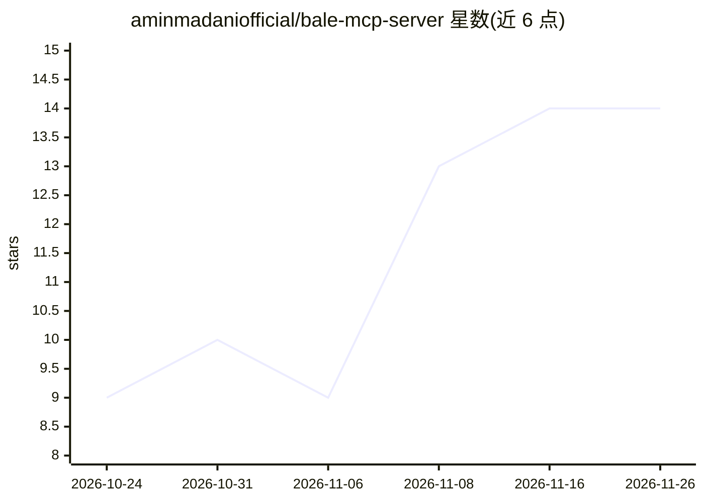

# aminmadaniofficial/bale-mcp-server

⭐ 14 · Python · MIT · 推送 2026-10-11 · [GitHub](https://github.com/aminmadaniofficial/bale-mcp-server) · 个人维护

**让 LLM 操作 Bale Messenger 账号的 MCP 服务器**

面向 Bale Messenger 的 Model Context Protocol 服务器，基于 aiobale-py 与官方 Python MCP SDK，通过 JSON-RPC（STDIO/SSE/Streamable HTTP）向 Claude Desktop、Cursor、Antigravity、Cline 等 LLM 客户端提供 34 个工具，覆盖认证与会话管理（多账号 .bale 会话自动发现切换、SMS/2FA 登录）、消息收发/编辑/转发/置顶、联系人管理与拉黑、群组频道管理、表情回应与输入状态。会话密钥保存在本地。需 Python 3.10+，从源码 git clone 后以 uv/pip 安装，附带 bale-mcp CLI 登录命令。

## 筛选速览

| 维度 | 判定 | 备注 |
|---|---|---|
| AI 角色 | `ai-ecosystem` | LLM/agent 周边工具 |
| 许可风险 | `permissive` | MIT |
| 部署形态 | `library` | 以包/库形式分发 |
| 模型依赖 | — | README 未给出锁定关系 |
| 硬件要求 | — | 无带数字的原话,不猜 |
| 安装摩擦 | `low` | 无编译、无系统依赖或容器化 |
| 成熟度 | — | 结构信号不足 |

## 能力要点

- 34 个 MCP 工具覆盖认证、消息、联系人、群组、回应五类操作
- 多账号会话管理，自动发现并切换本地 .bale 会话，无需重复输凭证
- 支持 Claude Desktop / Cursor / Antigravity / Cline 客户端接入
- 提供 bale-mcp login CLI 与程序化 SMS/2FA 登录工具

## 适用场景

- 在 Claude Desktop 或 Cursor 中通过对话收发 Bale 消息
- 让 AI agent 管理 Bale 群组、频道与联系人
- 多账号场景下让 LLM 切换不同 Bale 会话操作

## 场景标签

 · 领域:AI Agent 基础设施/即时通讯

## 证据(README 行号)

> L11: **Production-grade Model Context Protocol (MCP) server for Bale Messenger.**
> L30:                         │ JSON-RPC (STDIO / SSE / Streamable HTTP)

## 星数曲线

2026-10-24 9 → 2026-11-26 14（+5）

---
*卡片 v1 · prompt 1.4 · 生成 2026-11-18 · 置信度 high · 依据 README sha `e4e0d35ba682` · [字段定义](../../DATASET.md)*
