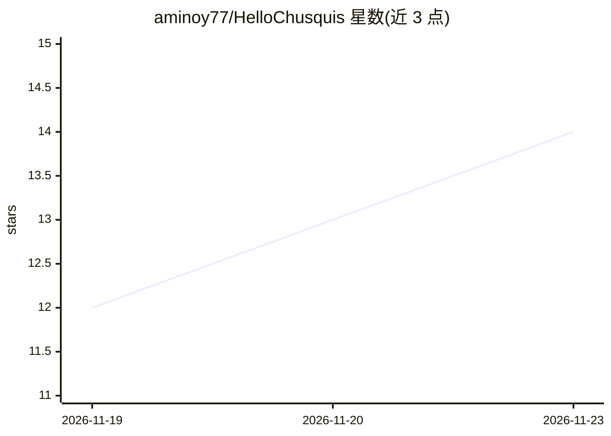

# aminoy77/HelloChusquis

⭐ 14 · Python · MIT · 推送 2026-11-20 · [GitHub](https://github.com/aminoy77/HelloChusquis) · [官网](https://aminoy77.github.io/HelloChusquis/) · 个人维护

**本地优先的终端 AI agent：对话、工具执行与记忆一体的工作台**

以 Python 包分发的终端 AI agent，同时提供 Web 界面、REST API 和 Telegram 三种入口。内置 shell、代码、文件、浏览器与网页搜索工具，覆盖 GitHub、Slack、Docker、AWS 等 48 个集成；provider 池支持多供应商回退切换。SQLite 本地存储会话、摘要与检索索引，附 1200+ markdown 参考知识文件注入记忆。带审批门、角色管理与审计记录等安全机制，MIT 许可。

## 筛选速览

| 维度 | 判定 | 备注 |
|---|---|---|
| AI 角色 | `ai-native` | 本体是模型或模型工具 |
| 许可风险 | `permissive` | MIT |
| 部署形态 | `library` | 以包/库形式分发 |
| 模型依赖 | locked-api |  |
| 硬件要求 | — | 无带数字的原话,不猜 |
| 安装摩擦 | `low` | 无编译、无系统依赖或容器化 |
| 成熟度 | — | 结构信号不足 |

## 能力要点

- 多 provider 池与回退机制（OpenRouter/Ollama/OpenAI 等 15+）
- Active Learning 从失败中沉淀规则，Tool Synthesis 按需生成 API 集成工具
- SQLite 本地记忆与 1200+ markdown 参考知识文件按轮召回
- 审批门 + viewer/operator/owner 角色与持久化审计记录

## 适用场景

- 在终端里让 agent 检查代码库、搜索网页并执行受限代码
- 通过 REST API 把 agent 能力接入自己的自动化流程
- 用 Telegram 远程与同一 agent 对话（仅白名单 chat）
- 小模型场景下借助本地知识库提升事实问答准确率

## 场景标签

`AI 助手` `Agent 记忆` · 领域:Agent 开发

## 证据(README 行号)

> L3: > **Terminal AI agent that builds its own tools — 48 integrations, local-first.**
> L9: HelloChusquis brings conversation, tools, memory, web access, code execution, and integrations into one developer-co
> L287: core/provider.py              Provider pool and fallback behavior

## 星数曲线

2026-11-19 12 → 2026-11-23 14（+2）

---
*卡片 v1 · prompt 1.4 · 生成 2026-11-19 · 置信度 high · 依据 README sha `aaa0fa6e7293` · [字段定义](../../DATASET.md)*
