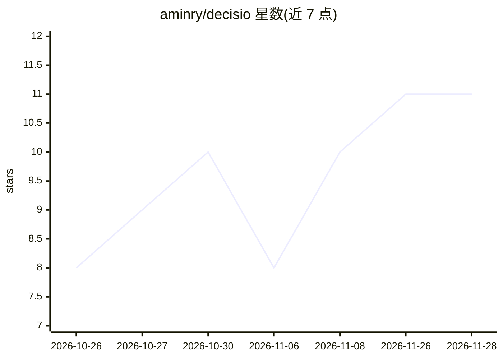

# aminry/decisio

⭐ 11 · Python · Apache-2.0 · 推送 2026-11-25 · [GitHub](https://github.com/aminry/decisio) · [官网](https://opendecisio.com) · 组织维护

**自托管决策推理服务器：输入分类问题，输出每个选项的校准概率**

Decisio 是一个开源推理服务器：文本输入后不经文本生成，直接从模型输出读取每个选项的概率，一次前向回答多个问题。支持三个基座（Gemma 4 31B/12B、Qwen3.6-35B-A3B），通过 POST /v1/tasks 提交标注示例即可拟合校准层、intent head、per-task temperature 与证书，无需重训练、权重冻结；带 certified 标记的错误率证书机制。需要标注示例（默认每选项 10 条另加 59 条留出），证书仅绑定单一任务与部署栈。PyPI 提供，Apache-2.0。

## 筛选速览

| 维度 | 判定 | 备注 |
|---|---|---|
| AI 角色 | `ai-ecosystem` | LLM/agent 周边工具 |
| 许可风险 | `permissive` | Apache-2.0 |
| 部署形态 | `self-host` | docker 或自建部署 |
| 模型依赖 | local-ok | 支持本地模型 |
| 硬件要求 | — | 无带数字的原话,不猜 |
| 安装摩擦 | `low` | 无编译、无系统依赖或容器化 |
| 成熟度 | — | 结构信号不足 |

## 能力要点

- 一次前向读取每个选项概率，不生成文本
- 标注示例拟合校准层与 intent head，模型权重冻结、免重训练
- certified true/false 证书机制：默认低于 59 条留出示例拒绝认证
- 三个基座，最长 32,768 令牌提示、255 选项/问题

## 适用场景

- 客服工单自动分流到具体队列并附带认证结果
- 意图分类任务在少量标注样本下快速上线
- 在自有 GPU/Mac 上对长文档批量提出多个判断问题

## 场景标签

`推理引擎` `数据分析` · 领域:效率与自动化

## 证据(README 行号)

> L9: **Decisio is an open-source server that answers typed questions about any text, with a calibrated probability for ev
> L60: How Decisio works: your text and your questions go in, a probability for every answer comes out
> L74: - **Long prompts, many options.** Prompts of 32,768 tokens on the Qwen base and, on the Gemma bases, of the largest

## 星数曲线

2026-10-26 8 → 2026-11-28 11（+3）

---
*卡片 v1 · prompt 1.4 · 生成 2026-11-20 · 置信度 mid · 依据 README sha `1073a63f68bf` · [字段定义](../../DATASET.md)*
