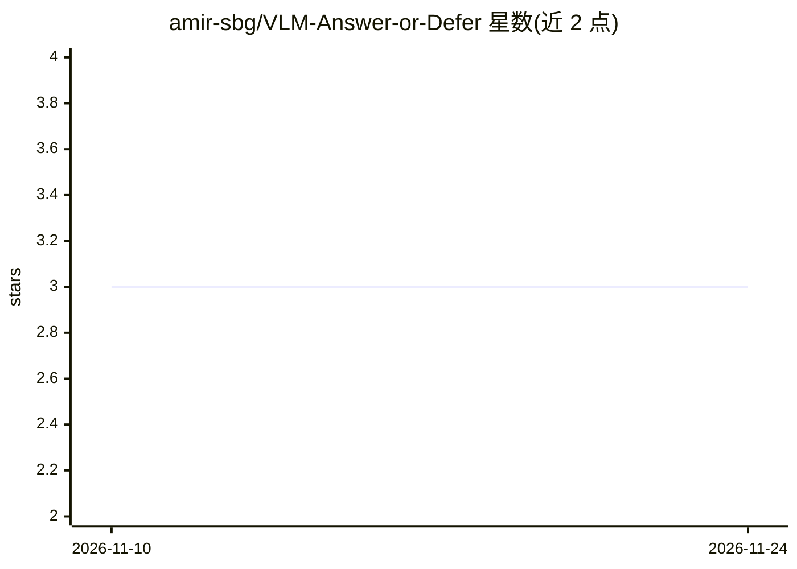

# amir-sbg/VLM-Answer-or-Defer

⭐ 3 · Python · MIT · 推送 2026-11-10 · [GitHub](https://github.com/amir-sbg/VLM-Answer-or-Defer) · [官网](https://amir-sbg.github.io/VLM-Answer-or-Defer/) · 组织维护

**评估 8 个 VLM 脑 MRI 置信度能否用于答题或转诊的研究代码**

论文配套研究代码：让 8 个开源权重 VLM（含 2 个推理模型）对 3,888 个脑 MRI 切片判断肿瘤/异常并自报 0-100 置信度，再用阈值门控评估 answer-or-defer 策略——是否存在可靠阈值可接受答案、其余转诊临床。数据用 BraTS 2024 与 IXI（不随库分发），参考标注由分割 mask 派生。含 vLLM/Transformers 推理、解析、统计（C_alpha、协方差分解、案例组合重加权、聚类 bootstrap）、make paper 全流程复现与 72 个测试。明确声明非临床诊断系统，不得用于患者诊疗。

## 筛选速览

| 维度 | 判定 | 备注 |
|---|---|---|
| AI 角色 | `ai-ecosystem` | LLM/agent 周边工具 |
| 许可风险 | `permissive` | MIT |
| 部署形态 | `None` |  |
| 模型依赖 | local-ok | 支持本地模型 |
| 硬件要求 | — | 无带数字的原话,不猜 |
| 安装摩擦 | `low` | 无编译、无系统依赖或容器化 |
| 成熟度 | — | 结构信号不足 |

## 能力要点

- 8 个 VLM × 3,888 脑 MRI 切片的置信度审计基准
- answer-or-defer 门控与 C_alpha 选择性风险指标
- make verify 重算论文全部数字，结果可溯源到单一决策表
- 协方差分解解释置信-正确相关在人群间反转

## 适用场景

- 复现或扩展 VLM 自报置信度的可靠性评估
- 医学影像场景中评估模型置信度能否支持自动接受/转诊决策
- 在部署前验证模型自述可靠信号的人群泛化性

## 场景标签

`模型评测` · 领域:评测与运维

## 证据(README 行号)

> L12: Research code for the paper:
> L97: - **Metrics**: sensitivity, specificity, balanced accuracy, predictive values,
> L141: - `src/inference/`: vLLM and Transformers runners, resumable and shardable

## 星数曲线

2026-11-10 3 → 2026-11-24 3（+0）

---
*卡片 v1 · prompt 1.4 · 生成 2026-11-22 · 置信度 high · 依据 README sha `c80ddb92c487` · [字段定义](../../DATASET.md)*
