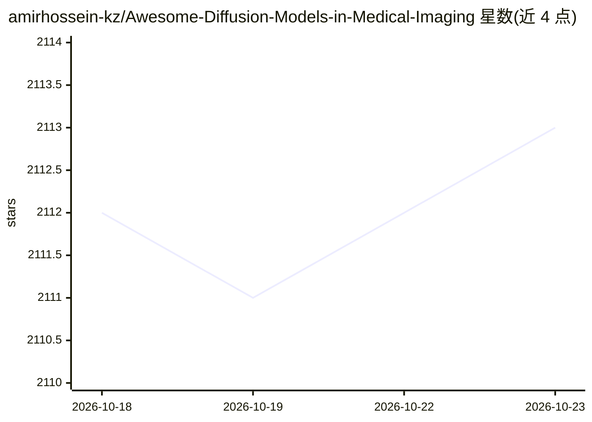

# amirhossein-kz/Awesome-Diffusion-Models-in-Medical-Imaging

⭐ 2,113 · MIT · 推送 2025-11-17 · [GitHub](https://github.com/amirhossein-kz/Awesome-Diffusion-Models-in-Medical-Imaging) · [官网](https://www.sciencedirect.com/science/article/pii/S1361841523001068) · 组织维护

**医学影像扩散模型论文清单：配套 MedIA 综述的持续整理**

由综述论文作者维护的医学影像扩散模型论文聚合仓库：配套发表于 Medical Image Analysis Journal 的综述《Diffusion Models in Medical Imaging: A Comprehensive Survey》，按 Survey Papers、Challenge Reports、Papers（含 Anomaly Detection 等子类）组织条目，每条列出作者、发表年份/出处与论文链接；收录范围覆盖异常检测、图像重建、图像生成、分割与图像翻译等应用方向，并附更新日志与引用信息（BibTeX）。仓库不含代码实现，MIT 许可。

## 筛选速览

| 维度 | 判定 | 备注 |
|---|---|---|
| AI 角色 | `ai-knowledge` | 知识聚合/清单类 |
| 许可风险 | `permissive` | MIT |
| 部署形态 | `None` |  |
| 模型依赖 | — | README 未给出锁定关系 |
| 硬件要求 | — | 无带数字的原话,不猜 |
| 安装摩擦 | `low` | 无编译、无系统依赖或容器化 |
| 成熟度 | — | 结构信号不足 |

## 能力要点

- 配套 Medical Image Analysis Journal 综述论文的论文清单
- 按综述、挑战赛报告与研究论文分类组织
- 条目含作者、发表年份/出处与论文链接
- 自 2022 年 11 月起持续更新（至 2025 年条目）

## 适用场景

- 查找医学影像领域的扩散模型论文
- 按异常检测等子方向追踪最新研究进展
- 引用配套综述时获取原文与 BibTeX

## 场景标签

`精选清单` · 领域:学习与行业

## 证据(README 行号)

> L6: :fire::fire: This is a collection of awesome articles about diffusion models in medical imaging:fire::fire:
> L8: - Our survey paper on MedIA: Diffusion Models in Medical Imaging: A Comprehensive Survey :heart:
> L29: ## Survey Papers

## 星数曲线

2026-10-18 2,112 → 2026-10-23 2,113（+1）

---
*卡片 v1 · prompt 1.4 · 生成 2026-10-21 · 置信度 high · 依据 README sha `a7443a3c7465` · [字段定义](../../DATASET.md)*
