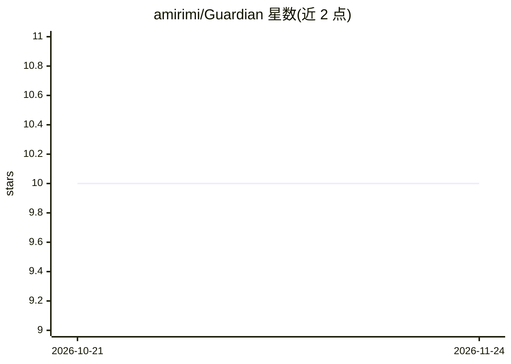

# amirimi/Guardian

⭐ 10 · Go · 推送 2026-10-16 · [GitHub](https://github.com/amirimi/Guardian) · 个人维护

**LLM 护栏微内核：分流安全插件并限流配额**

Go 编写的 LLM 守护微内核，将用户请求分发给已连接的安全插件，汇总插件响应判定提示词是否恶意；同时可作速率限制器、认证单元与配额管理。采用可扩展的微内核架构，支持 HTTP/1.1 与 gRPC 插件及可复用 gRPC 客户端，默认依赖 MongoDB，使用 Google Wire 做编译期依赖注入，附 60 秒负载测试对比数据与 Docker Compose 部署方式。

## 筛选速览

| 维度 | 判定 | 备注 |
|---|---|---|
| AI 角色 | `ai-ecosystem` | LLM/agent 周边工具 |
| 许可风险 | `none` | — |
| 部署形态 | `self-host` | docker 或自建部署 |
| 模型依赖 | — | README 未给出锁定关系 |
| 硬件要求 | — | 无带数字的原话,不猜 |
| 安装摩擦 | `low` | 无编译、无系统依赖或容器化 |
| 成熟度 | — | 结构信号不足 |

## 能力要点

- 微内核架构：请求分发至安全插件并汇总判定恶意/良性
- 支持 HTTP/1.1 与 gRPC 插件，gRPC 客户端可复用
- 兼作速率限制器、认证与配额管理
- 默认 MongoDB，数据库不可知设计

## 适用场景

- 在 LLM 应用入口拦截恶意提示词
- 为用户/用户组配置任务与配额限制
- 以插件形式扩展自定义安全策略

## 场景标签

`网络安全` · 领域:学习与行业

## 证据(README 行号)

> L5: A plug-and-play end-to-end LLM guardian for seamless integration.
> L8: is malicious or benign. You can also use the kernel as a rate limiter, authentication unit, or quota management. It 
> L12: - Microkernel architecture: Open to extension

## 星数曲线

2026-10-21 10 → 2026-11-24 10（+0）

---
*卡片 v1 · prompt 1.4 · 生成 2026-11-20 · 置信度 high · 依据 README sha `39b21cd8209b` · [字段定义](../../DATASET.md)*
