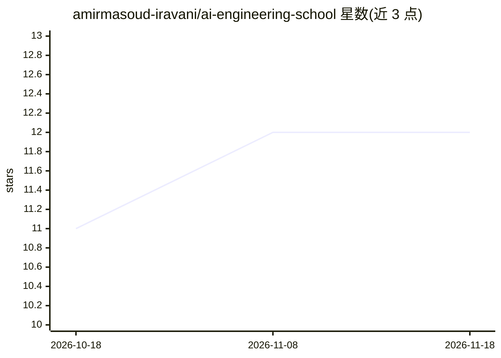

# amirmasoud-iravani/ai-engineering-school

⭐ 12 · Jupyter Notebook · 推送 2026-08-12 · [GitHub](https://github.com/amirmasoud-iravani/ai-engineering-school) · 个人维护

**AI 工程入门教程仓库：从 Python 基础到 MLOps 的分阶段学习路径**

以分阶段文件夹组织的 AI 工程学习仓库：每个文件夹是一个阶段，每个 notebook 是一节课，每段代码是一个小实验，并配练习与项目。已完成的阶段覆盖 Python、NumPy、pandas、Matplotlib 与防泄漏数据预处理（阶段 01–05）；阶段 06–10 目前仅提供机器学习、深度学习、MLOps、AI 应用与端到端项目的课程地图。提供 venv 环境搭建与 Jupyter Lab 运行说明，学习路径按编号顺序推进。

## 筛选速览

| 维度 | 判定 | 备注 |
|---|---|---|
| AI 角色 | `ai-knowledge` | 知识聚合/清单类 |
| 许可风险 | `none` | — |
| 部署形态 | `library` | 以包/库形式分发 |
| 模型依赖 | — | README 未给出锁定关系 |
| 硬件要求 | — | 无带数字的原话,不猜 |
| 安装摩擦 | `low` | 无编译、无系统依赖或容器化 |
| 成熟度 | — | 结构信号不足 |

## 能力要点

- 按阶段组织的课程结构：folder=阶段、notebook=课程、cell=实验
- 已完成阶段覆盖 Python→NumPy→pandas→Matplotlib→数据预处理
- 阶段 06–10 提供 ML/深度学习/MLOps/AI 应用的课程地图
- 每课配有练习、参考答案与阶段项目

## 适用场景

- 从零开始系统学习 Python 与数据科学基础
- 按路径自学到机器学习与 MLOps 入门
- 通过运行和修改 notebook 巩固每节课的概念

## 场景标签

`教程课程` · 领域:学习与行业

## 证据(README 行号)

> L3: A beginner-friendly learning repository for moving from **Python fundamentals** to building and operating AI systems
> L5: The repository is organized as a sequence of stages:
> L38: Stages `01`–`05` are complete. Stages `06`–`10` currently provide lesson maps for machine learning, deep learning, 

## 星数曲线

2026-10-18 11 → 2026-11-18 12（+1）

---
*卡片 v1 · prompt 1.4 · 生成 2026-11-18 · 置信度 high · 依据 README sha `4b10e58e26d2` · [字段定义](../../DATASET.md)*
