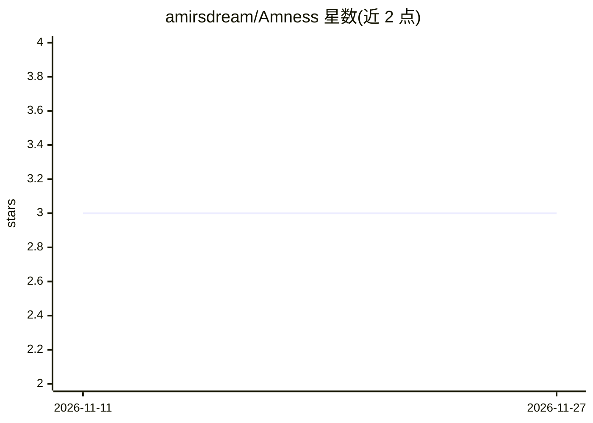

# amirsdream/Amness

⭐ 3 · TypeScript · MIT · 推送 2026-11-15 · [GitHub](https://github.com/amirsdream/Amness) · 个人维护

**终端编程 agent 运行框架：任何模型 + 可视化防护栏**

基于 Node 的终端/桌面编程 agent 客户端：流式 TUI 对话、权限模式、plan 模式、undo、记忆、MCP 工具。核心机制是 /advanced 视图把会话展开为八步流程图（Hooks→Context→Model→Tools→Guards→Finish），可逐步暂停、编辑请求与回复、回放和分叉；--verify 证明命令强制测试通过才能结束；支持 token 预算与 eval 变体对比实验。目标用户是希望自选模型、自写防护栏并验证改动的进阶用户；README 自述新功能已测试但未在真实任务中验证。

## 筛选速览

| 维度 | 判定 | 备注 |
|---|---|---|
| AI 角色 | `ai-ecosystem` | LLM/agent 周边工具 |
| 许可风险 | `permissive` | MIT |
| 部署形态 | `self-host` | docker 或自建部署 |
| 模型依赖 | local-ok | 支持本地模型 |
| 硬件要求 | — | 无带数字的原话,不猜 |
| 安装摩擦 | `low` | 无编译、无系统依赖或容器化 |
| 成熟度 | `idea` | |

## 能力要点

- /advanced 会话流程图：逐步查看/暂停/编辑模型请求、工具调用与结束判定
- --verify 证明命令与摘要真实性比对，退出码可用于 CI
- 本地模型路径（Ollama）无需 API key，代码不出本机
- amness-desktop 桌面应用与 amness serve 浏览器/HTTP API 形态

## 适用场景

- 让 agent 修代码，diff 逐条审批并可用 /undo 回滚
- 在 CI 里用 --verify 跑可信任退出码的自动修复任务
- 用本地模型处理不想外发的代码
- 用 eval 对比不同防护栏/模型配置的实际效果

## 场景标签

`编码 Agent` · 领域:编码与开发

## 证据(README 行号)

> L3: **An advanced, hackable harness for coding agents.** Any model, your own keys, and every part of the loop (guardrail
> L12: > **Who is this for?** Power users who outgrow closed tools: people who want to choose the model, read the loop, wr

## 星数曲线

2026-11-11 3 → 2026-11-27 3（+0）

---
*卡片 v1 · prompt 1.4 · 生成 2026-11-22 · 置信度 high · 依据 README sha `a22a61bc4ef6` · [字段定义](../../DATASET.md)*
