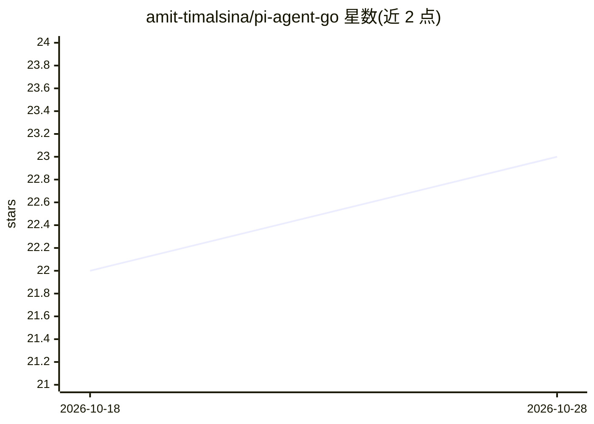

# amit-timalsina/pi-agent-go

⭐ 23 · Go · NOASSERTION · 推送 2026-10-13 · [GitHub](https://github.com/amit-timalsina/pi-agent-go) · [官网](https://pkg.go.dev/github.com/amit-timalsina/pi-agent-go) · 个人维护

**Go 语言单循环 LLM 工具调用 agent 框架**

基于 pi-llm-go 的极简 Go agent 框架，实现单循环工具调用（输入→工具调用→响应→循环至完成），约 1k 行可读源码。提供类型化工具处理器（反射生成 JSON Schema）、并行工具执行、三个控制钩子（BeforeToolCall/AfterToolCall/OnSteering）、流式工具进度、运行中转向（Steer）、跨迭代 prompt 缓存与快照恢复（Snapshot/Restore）。支持 Anthropic Claude、OpenAI、Google Gemini 及 OpenAI 兼容端点。刻意不包含多 agent 编排与会话持久化，这些留给应用层。需 Go 1.25+。

## 筛选速览

| 维度 | 判定 | 备注 |
|---|---|---|
| AI 角色 | `ai-ecosystem` | LLM/agent 周边工具 |
| 许可风险 | `permissive` | NOASSERTION |
| 部署形态 | `None` |  |
| 模型依赖 | locked-api |  |
| 硬件要求 | — | 无带数字的原话,不猜 |
| 安装摩擦 | `low` | 无编译、无系统依赖或容器化 |
| 成熟度 | — | 结构信号不足 |

## 能力要点

- 类型化工具处理器，反射生成 JSON Schema
- 三个控制钩子与运行中转向（Steer）注入用户消息
- Snapshot/Restore 快照恢复，支持进程重启后继续
- 跨迭代 Anthropic prompt 缓存配置转发

## 适用场景

- 用 Go 快速搭建单循环工具调用 agent，支持多家模型商
- 长时运行 agent 需要中途干预或断点恢复
- 在工具调用流程中插入自定义前置/后置控制逻辑

## 场景标签

`Agent 框架` · 领域:Agent 开发

## 证据(README 行号)

> L8: **Minimal Go agent framework for LLM tool-calling loops.** Single-loop agent on top of `pi-llm-go`: input → optional
> L39: Works with any provider implementing pi-llm-go's `LLM` interface: Anthropic Claude, OpenAI (Chat + Responses), Goog
> L54: |A single-loop tool-calling agent in Go, multi-provider, ~1kLoC to read|**pi-agent-go**|

## 星数曲线

2026-10-18 22 → 2026-10-28 23（+1）

---
*卡片 v1 · prompt 1.4 · 生成 2026-10-27 · 置信度 high · 依据 README sha `aaffb7cdf05a` · [字段定义](../../DATASET.md)*
