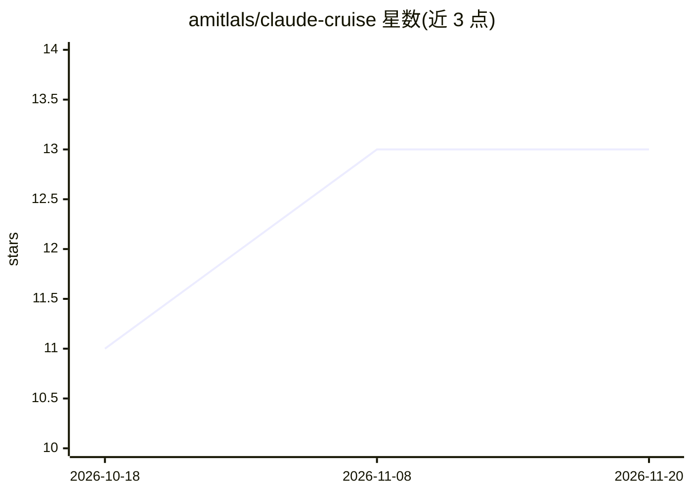

# amitlals/claude-cruise

⭐ 13 · TypeScript · MIT · 推送 2026-11-07 · [GitHub](https://github.com/amitlals/claude-cruise) · [官网](https://amitlals.github.io/claude-cruise/) · 个人维护

**给 Claude Code 用户的本地代理：自动切换后备模型避免触发限流**

位于 Claude Code 与 Anthropic API 之间的本地透明代理，运行在 localhost:4141。按用量分级路由：0-70% 用 Sonnet、70-85% 切 Haiku、85-95% 切 OpenRouter、95% 以上切本地 Ollama；命中 429 后记录触发 token 数并切换，约 5 小时后回到主模型。附带 Web 仪表盘显示用量仪表、当前模型、成本追踪与请求日志。仅适用于基于 API 的工具（Claude Code CLI/扩展、ANTHROPIC_BASE_URL 应用），不支持 claude.ai 网页版、移动端与桌面端。npm 包尚未发布，当前需克隆仓库运行，需 Node.js v18+ 与 Anthropic API key。

## 筛选速览

| 维度 | 判定 | 备注 |
|---|---|---|
| AI 角色 | `ai-ecosystem` | LLM/agent 周边工具 |
| 许可风险 | `permissive` | MIT |
| 部署形态 | `library` | 以包/库形式分发 |
| 模型依赖 | local-ok | 支持本地模型 |
| 硬件要求 | — | 无带数字的原话,不猜 |
| 安装摩擦 | `low` | 无编译、无系统依赖或容器化 |
| 成熟度 | `idea` | |

## 能力要点

- 按用量分级自动路由：Sonnet→Haiku→OpenRouter→Ollama 本地
- 命中 429 后记录 token 阈值并即时切换，约 5 小时后恢复主模型
- 本地 Web 仪表盘：用量仪表、模型状态、成本追踪、请求日志
- API key 仅在本机使用，代理本地运行

## 适用场景

- 使用 Claude Code 时在接近配额上限前自动切换后备模型
- 在仪表盘中追踪每次会话与每周的 token 成本
- 通过 Ollama 本地模型作为配额耗尽时的免费后备

## 场景标签

`模型网关` · 领域:Agent 开发

## 证据(README 行号)

> L16: **Claude Cruise** is a smart proxy that sits between Claude Code and the Anthropic API.
> L260: When you approach your rate limit, Claude Cruise automatically switches to cheaper/backup models:
> L273: 1. **Detection** — Cruise sees the rate limit error

## 星数曲线

2026-10-18 11 → 2026-11-20 13（+2）

---
*卡片 v1 · prompt 1.4 · 生成 2026-11-18 · 置信度 high · 依据 README sha `c8642ccd00f8` · [字段定义](../../DATASET.md)*
