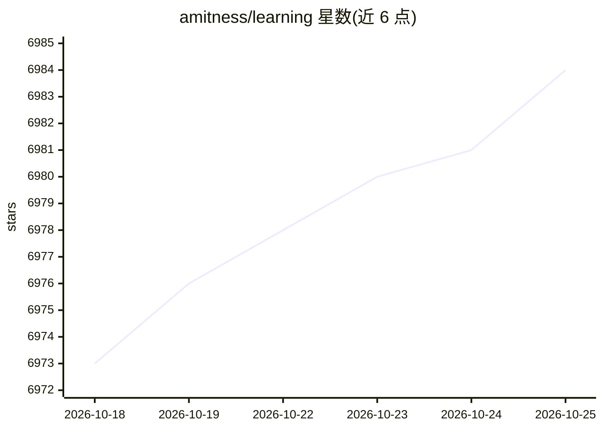

# amitness/learning

⭐ 6,986 · MIT · 推送 2026-10-02 · [GitHub](https://github.com/amitness/learning) · [官网](https://twitter.com/amitness) · 个人维护

**个人学习记录：按技能领域整理的课程与书籍清单**

维护者以表格形式记录自己正在学习的资源，分为通用技能（系统设计、数学、数据结构与算法、SQL、Linux、Git、测试、技术写作、Python 等）与专业技能（生成式 AI：NLP、LLM 理论、RLHF 后训练、多模态等）两大板块，每条含格式、时长与完成进度。当前标注的学习焦点为生成式 AI，每月更新。内容为课程/书籍链接的策展清单，不提供代码或安装方式，仅供浏览参考。

## 筛选速览

| 维度 | 判定 | 备注 |
|---|---|---|
| AI 角色 | `ai-knowledge` | 知识聚合/清单类 |
| 许可风险 | `permissive` | MIT |
| 部署形态 | `None` |  |
| 模型依赖 | — | README 未给出锁定关系 |
| 硬件要求 | — | 无带数字的原话,不猜 |
| 安装摩擦 | `medium` | 含编译或系统依赖之一 |
| 成熟度 | — | 结构信号不足 |

## 能力要点

- 按通用技能与专业技能两大板块组织的资源表格
- 每条资源标注格式、时长与完成进度
- 生成式 AI 部分覆盖 NLP、LLM 理论、RLHF/RLVR 后训练、多模态

## 适用场景

- 查找机器学习与 LLM 相关的系统化学习资源
- 参考他人的软件工程技能学习路径与进度组织方式
- 了解 LLM 训练与后训练主题的书籍和讲座线索

## 场景标签

`教程课程` `精选清单` · 领域:学习与行业

## 证据(README 行号)

> L3: A running log of things I'm learning to build strong software engineering skills while also expanding my knowledge o
> L5: **Updated**: Once a month | **Current** **Focus**: Generative AI
> L183: ### Generative AI

## 星数曲线

2026-10-18 6,973 → 2026-10-25 6,984（+11）

---
*卡片 v1 · prompt 1.4 · 生成 2026-10-20 · 置信度 high · 依据 README sha `91672c316867` · [字段定义](../../DATASET.md)*
