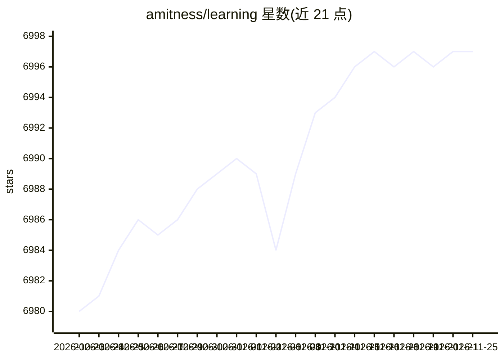

# amitness/learning

⭐ 6,997 · MIT · 推送 2026-11-01 · [GitHub](https://github.com/amitness/learning) · [官网](https://twitter.com/amitness) · 个人维护

**个人学习记录：AI/软件工程学习资源清单与进度追踪**

作者以表格形式记录自己学习过的书籍、课程与视频，按通用技能（系统设计、数学、算法、SQL、Linux、Git、技术写作、Python）与专项技能（NLP、LLM 理论、后训练/RLHF、多模态）分类组织，逐条标注资源格式、时长/页数与完成进度。当前关注方向为生成式 AI，每月更新一次。不含可运行的代码或安装说明，仅作为资源清单与进度日志供浏览。

## 筛选速览

| 维度 | 判定 | 备注 |
|---|---|---|
| AI 角色 | `ai-knowledge` | 知识聚合/清单类 |
| 许可风险 | `permissive` | MIT |
| 部署形态 | `None` |  |
| 模型依赖 | — | README 未给出锁定关系 |
| 硬件要求 | — | 无带数字的原话,不猜 |
| 安装摩擦 | `medium` | 含编译或系统依赖之一 |
| 成熟度 | — | 结构信号不足 |

## 能力要点

- 按通用技能与专项技能两级分类组织学习资源
- 每条资源标注格式、页数/时长与完成进度标记
- 覆盖 NLP、LLM 理论、RLHF/后训练与视觉多模态等方向
- 每月更新，当前聚焦生成式 AI

## 适用场景

- 查找 AI 与软件工程方向的学习资源线索
- 参考他人规划的系统化学习路径
- 了解 LLM 后训练与 RLHF 的入门材料有哪些

## 场景标签

`精选清单` · 领域:学习与行业

## 证据(README 行号)

> L3: A running log of things I'm learning to build strong fundamentals while also expanding my knowledge of adjacent tech
> L5: **Updated**: Once a month | **Current** **Focus**: Generative AI

## 星数曲线

2026-10-23 6,980 → 2026-11-25 6,997（+17）

---
*卡片 v1 · prompt 1.4 · 生成 2026-11-22 · 置信度 high · 依据 README sha `03cea7542f42` · [字段定义](../../DATASET.md)*
