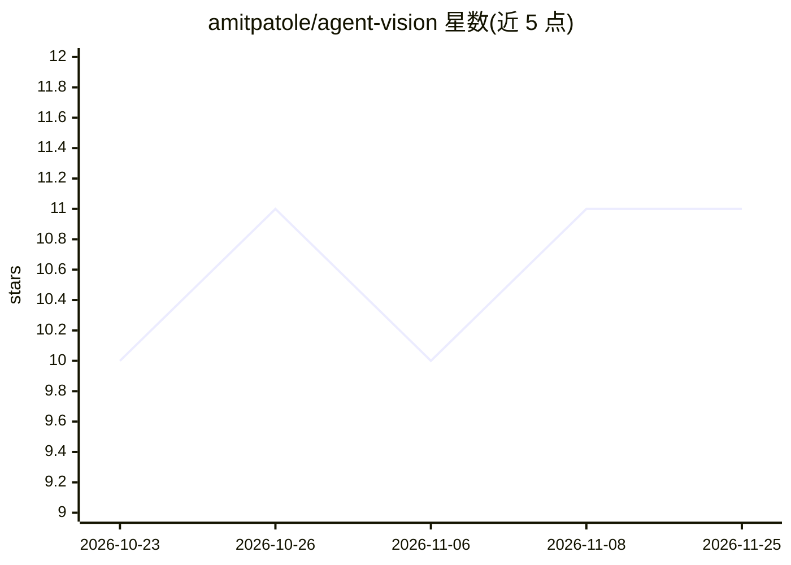

# amitpatole/agent-vision

⭐ 11 · Python · MIT · 推送 2026-10-24 · [GitHub](https://github.com/amitpatole/agent-vision) · [官网](https://pypi.org/project/agentvision/) · 个人维护

**给 AI 编码 agent 的视觉反馈循环：渲染→感知→报告→修复**

面向 AI 编码 agent 的视觉自检框架：渲染 HTML/图片/PDF/Office 文件后，基于 DOM 几何、计算样式对比度、OCR 词框与控制台/网络捕获生成机器可读的分级报告（pass/warn/fail）与坐标定位的问题清单，供 agent 在声明完成前自我修正。支持可选视觉 LLM 后端（默认本地无密钥路径），提供库、CLI、MCP server、REST 服务、Claude Code Skill 等多种接入面，并可与 Verel 框架配合。需要 Chromium、Tesseract、poppler 等系统依赖。

## 筛选速览

| 维度 | 判定 | 备注 |
|---|---|---|
| AI 角色 | `ai-ecosystem` | LLM/agent 周边工具 |
| 许可风险 | `permissive` | MIT |
| 部署形态 | `self-host` | docker 或自建部署 |
| 模型依赖 | local-ok | 支持本地模型 |
| 硬件要求 | — | 无带数字的原话,不猜 |
| 安装摩擦 | `low` | 无编译、无系统依赖或容器化 |
| 成熟度 | — | 结构信号不足 |

## 能力要点

- 渲染→感知→报告→修复→重渲染的闭环，输出 Handoff 结构供 agent 循环使用
- DOM 几何/对比度/OCR/网络捕获等可溯源依据，local 后端无需 API key
- 支持 PDF/Office 逐页栅格化评分，PPT 离线检查无出口流量
- 多种接入面：Python 库、CLI、MCP server、REST、Claude Code Skill、GitHub Action

## 适用场景

- 让编码 agent 在提交 UI 前自检溢出/低对比度/截断文本
- CI 中对构建产物做视觉 FAIL 门禁
- 对 PPT/信息图按意图清单做符合性检查
- 多 agent 并行产出时统一视觉验收标准

## 场景标签

`编码 Agent` · 领域:编码与开发

## 证据(README 行号)

> L13: AgentVision is a provider-agnostic framework that closes the visual feedback loop for AI
> L147: |**CLI** (`agentvision …`)|Any agent that can run a shell command; CI|
> L149: |**MCP server** (`agentvision-mcp`)|Cursor, Claude, any MCP-capable host|

## 星数曲线

2026-10-23 10 → 2026-11-25 11（+1）

---
*卡片 v1 · prompt 1.4 · 生成 2026-11-18 · 置信度 mid · 依据 README sha `20f2716cfe10` · [字段定义](../../DATASET.md)*
