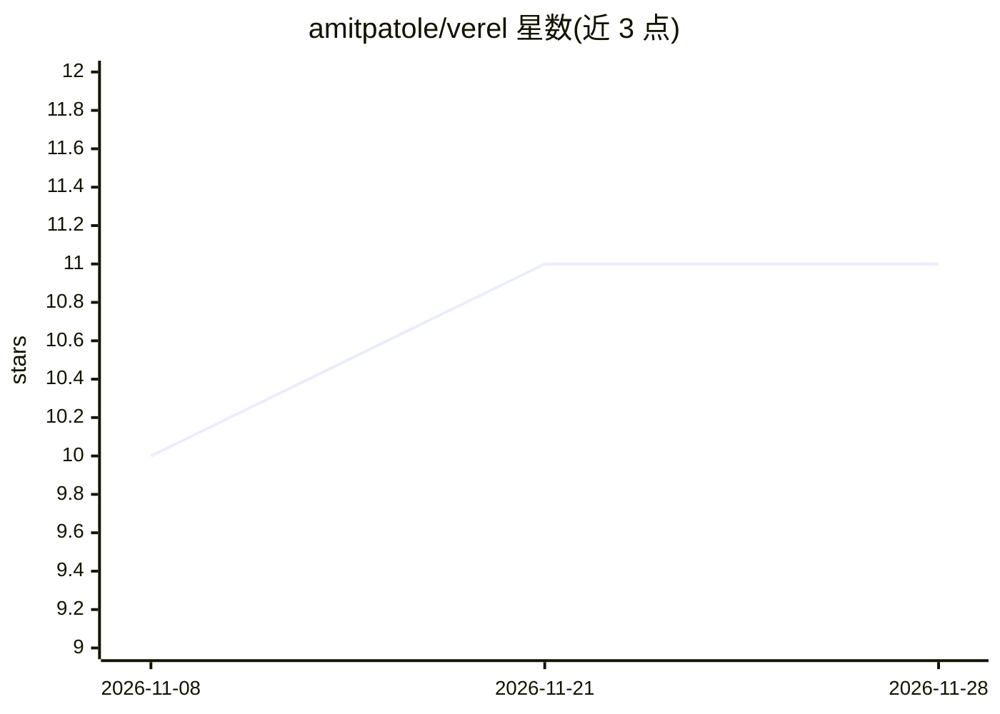

# amitpatole/verel

⭐ 11 · Python · MIT · 推送 2026-10-23 · [GitHub](https://github.com/amitpatole/verel) · [官网](https://huggingface.co/spaces/amitpatole/verel) · 个人维护

**以评分裁决为门槛的 agent 框架：动作须经验证才算完成**

Verel 是一个 Python 编写的 agent 框架，核心机制是 verdict bus：将视觉、测试、lint、类型等感官统一为 pass/warn/fail 裁决，agent 的每个动作作为假设被 grader 评定，只有通过验证的成果才写入共享记忆。包含七个模块：已验证记忆（基于 FTS5 BM25 检索、多源佐证信任机制）、AgentVision 视觉感知、文档入口防护（静态扫描隐藏内容与提示注入）、agent 管理队列（隔离 git worktree）、自建工具沙箱、agent 运行的 CI/CD 流水线、影子到强制的灰度发布。以库、CLI、MCP server 多种形态提供，默认使用 Ollama Cloud 作为 LLM，可通过环境变量切换到 OpenAI 或 Claude。

## 筛选速览

| 维度 | 判定 | 备注 |
|---|---|---|
| AI 角色 | `ai-ecosystem` | LLM/agent 周边工具 |
| 许可风险 | `permissive` | MIT |
| 部署形态 | `library` | 以包/库形式分发 |
| 模型依赖 | local-ok | 支持本地模型 |
| 硬件要求 | — | 无带数字的原话,不猜 |
| 安装摩擦 | `low` | 无编译、无系统依赖或容器化 |
| 成熟度 | — | 结构信号不足 |

## 能力要点

- verdict bus 将视觉/测试/lint/类型统一为 pass/warn/fail 裁决并带 grader attestation
- 验证式记忆：事实须经 attestation 或 ≥2 个已认证来源佐证才被信任
- self-heal 流水线：失败测试由 agent 修补源码并重新裁决，直至 grader 通过
- 文档入口防护：静态扫描 docx/pdf 等文件中的隐藏指令与提示注入

## 适用场景

- 为 CI 流水线增加统一裁决门槛，由 agent 自动修复失败测试
- 多个 agent 协作开发时用隔离 worktree 与预算调度管理队列
- 对进入 LLM 上下文的文档做提示注入与隐藏内容防护
- 将评分器从影子模式灰度升级为强制模式并保留可审计日志

## 场景标签

`Agent 框架` · 领域:Agent 开发

## 证据(README 行号)

> L3:  Verel — the agent framework where nothing is done until a grader returns a verdict
> L19: Verel is an agent framework built on the idea that **every agent action is a hypothesis**:
> L118: |**CLI** (`verel …`)|`doctor` · `loop` · `fleet` · `heal` · `ci`|

## 星数曲线

2026-11-08 10 → 2026-11-28 11（+1）

---
*卡片 v1 · prompt 1.4 · 生成 2026-11-20 · 置信度 high · 依据 README sha `f99a31819bba` · [字段定义](../../DATASET.md)*
