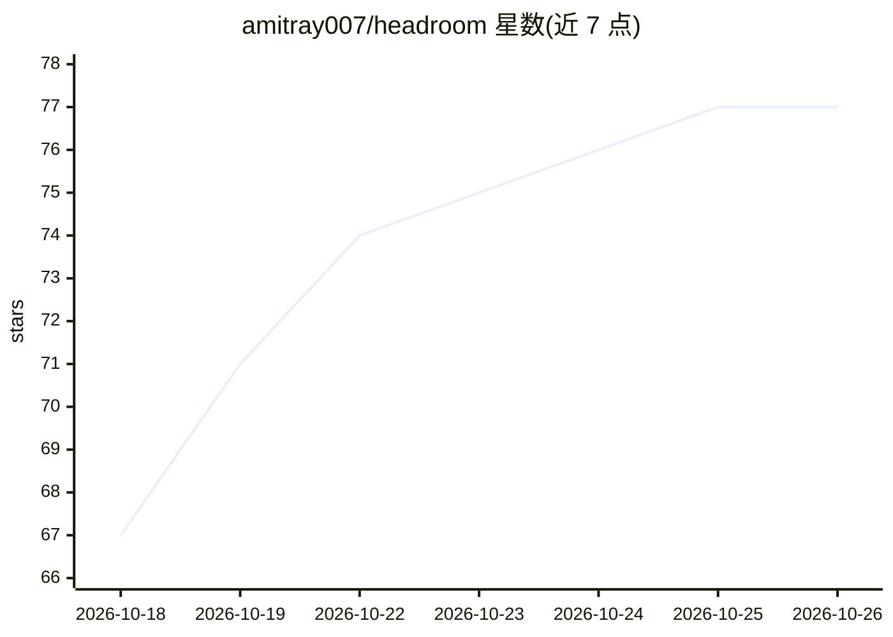

# amitray007/headroom

⭐ 77 · TypeScript · MIT · 推送 2026-10-25 · [GitHub](https://github.com/amitray007/headroom) · [官网](https://headroom.theblank.club) · 个人维护

**自托管仪表盘：统一追踪多个 AI 订阅的额度与花费**

面向持有多个 AI 订阅（Claude、Codex、Cursor、Copilot、Grok、Antigravity、Vercel AI Gateway）的用户，在自有服务器上运行的 Web 仪表盘：登录各账号后后台刷新，集中展示剩余额度、重置时间、信用余额与花费，并按余量推荐下一个该用的账号。提供额度告警（应用内/Telegram/webhook）、花费统计与自动动作用规则。凭据以 AES-256-GCM 加密封存，主密钥不入库；默认只读不发送模型请求。注意：读取私有 provider 端点存在账号被限制的风险（README 明确警告）。

## 筛选速览

| 维度 | 判定 | 备注 |
|---|---|---|
| AI 角色 | `ai-ecosystem` | LLM/agent 周边工具 |
| 许可风险 | `permissive` | MIT |
| 部署形态 | `self-host` | docker 或自建部署 |
| 模型依赖 | locked-api |  |
| 硬件要求 | — | 无带数字的原话,不猜 |
| 安装摩擦 | `low` | 无编译、无系统依赖或容器化 |
| 成熟度 | — | 结构信号不足 |

## 能力要点

- 7 个 provider 的额度、重置、信用与花费集中展示
- Compare 按余量对账号排序并推荐下一个使用的账号
- 凭据 AES-256-GCM 加密，主密钥保存在数据库之外
- 额度不足/重置/预算告警：应用内通知、Telegram、签名 webhook

## 适用场景

- 多个 AI 订阅账号的额度与重置时间一目了然
- 避免任务中途因账号额度耗尽而失败
- 统计各订阅的花费并设置预算告警

## 场景标签

`LLM 可观测性` · 领域:评测与运维

## 证据(README 行号)

> L7: Self-hosted dashboard for Claude, Codex, Cursor, Copilot, Grok, Antigravity and Vercel AI Gateway.
> L29: You pay for several AI plans, often more than one account each. Each one shows its limits somewhere else, in a diff

## 星数曲线

2026-10-18 67 → 2026-10-26 77（+10）

---
*卡片 v1 · prompt 1.4 · 生成 2026-10-24 · 置信度 high · 依据 README sha `f81c8d0c8135` · [字段定义](../../DATASET.md)*
