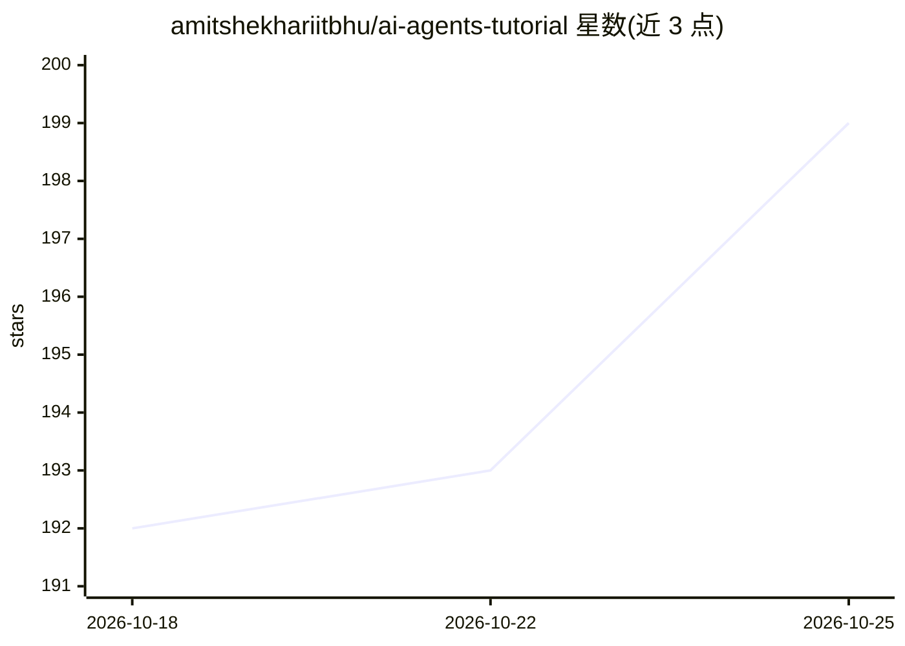

# amitshekhariitbhu/ai-agents-tutorial

⭐ 199 · Apache-2.0 · 推送 2026-10-24 · [GitHub](https://github.com/amitshekhariitbhu/ai-agents-tutorial) · [官网](https://outcomeschool.com/program/ai-and-machine-learning) · 个人维护

**AI Agent 从零到多智能体的分步教程合集**

由 Outcome School 创始人 Amit Shekhar 维护的 AI Agent 学习教程目录，以博客与视频链接形式按主题组织：涵盖 Function Calling、Agent Loop、ReAct/Reflection/Plan-and-Execute Agent、Agent 记忆、Context Engineering、Agentic RAG、GraphRAG、多智能体系统、SubAgents、MCP、编排与智能体通信、Computer-Use 与 Browser Agent 等主题，每篇列出涵盖要点并指向正文。README 声明系列会随新博客与视频持续扩充；仓库本身不含代码或安装物。

## 筛选速览

| 维度 | 判定 | 备注 |
|---|---|---|
| AI 角色 | `ai-knowledge` | 知识聚合/清单类 |
| 许可风险 | `permissive` | Apache-2.0 |
| 部署形态 | `None` |  |
| 模型依赖 | — | README 未给出锁定关系 |
| 硬件要求 | — | 无带数字的原话,不猜 |
| 安装摩擦 | `low` | 无编译、无系统依赖或容器化 |
| 成熟度 | — | 结构信号不足 |

## 能力要点

- 按主题分步组织：从 Function Calling 到多智能体与编排
- 覆盖 ReAct、Reflection、Plan-and-Execute、Agentic RAG、GraphRAG 等 Agent 模式讲解
- 每篇教程以要点清单列出内容范围
- 系列随作者博客与视频持续更新

## 适用场景

- 系统学习 AI Agent 的概念与工作原理
- 了解 Agent Loop、MCP、多智能体编排等专题
- 作为构建 Agent 应用前的知识入门材料

## 场景标签

`教程课程` · 领域:学习与行业

## 证据(README 行号)

> L5: **Learn AI Agents step by step, from scratch - from function calling to agent loops to multi-agent systems, orchestr
> L7: Prepared and maintained by the **Founder** of Outcome School: Amit Shekhar

## 星数曲线

2026-10-18 192 → 2026-10-25 199（+7）

---
*卡片 v1 · prompt 1.4 · 生成 2026-10-22 · 置信度 high · 依据 README sha `ce92966c349d` · [字段定义](../../DATASET.md)*
