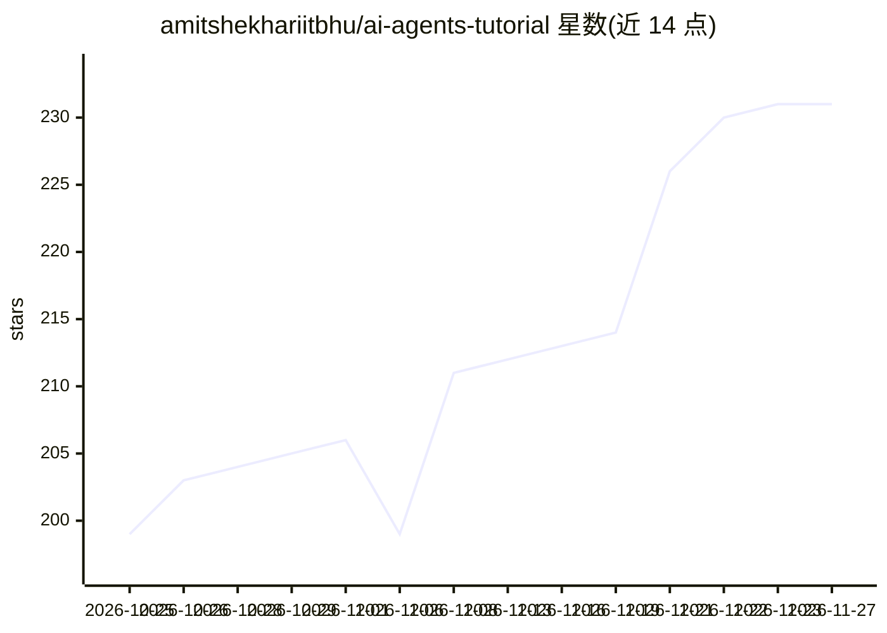

# amitshekhariitbhu/ai-agents-tutorial

⭐ 231 · Apache-2.0 · 推送 2026-11-26 · [GitHub](https://github.com/amitshekhariitbhu/ai-agents-tutorial) · [官网](https://outcomeschool.com/program/ai-and-machine-learning) · 个人维护

**从零学习 AI Agent 的系列教程：函数调用到多智能体**

由 Outcome School 创始人 Amit Shekhar 维护的 AI Agent 学习教程合集，以博客与视频形式组织，主题覆盖 LLM/RAG/MCP 基础、函数调用、Agent Loop、ReAct/Reflection/Plan-and-Execute 等代理模式、Agent 记忆、上下文工程、Agentic RAG、GraphRAG、多智能体系统、编排、Agent 通信、计算机与浏览器代理等。README 为各篇教程提供章节大纲与入口链接，作者声明系列会持续扩展新主题。

## 筛选速览

| 维度 | 判定 | 备注 |
|---|---|---|
| AI 角色 | `ai-knowledge` | 知识聚合/清单类 |
| 许可风险 | `permissive` | Apache-2.0 |
| 部署形态 | `None` |  |
| 模型依赖 | — | README 未给出锁定关系 |
| 硬件要求 | — | 无带数字的原话,不猜 |
| 安装摩擦 | `low` | 无编译、无系统依赖或容器化 |
| 成熟度 | — | 结构信号不足 |

## 能力要点

- 覆盖函数调用、Agent Loop 到多智能体与评估的渐进式主题序列
- 含 ReAct、Reflection、Plan-and-Execute 等代理模式的实现与失败模式讲解
- 包含 MCP、Agent 通信协议、Computer-Use 与 Browser Agent 等专题
- 每篇教程附完整章节大纲

## 适用场景

- 系统学习从基础到多智能体的 AI Agent 概念与实现
- 开发 AI Agent 前了解常见代理模式与失败模式
- 理解 MCP、Agent 记忆与上下文工程等专题机制

## 场景标签

`教程课程` · 领域:学习与行业

## 证据(README 行号)

> L5: **Learn AI Agents step by step, from scratch - from function calling to agent loops to multi-agent systems, orchestr
> L28: In this blog, we will learn about the AI Agent - what it is, how it is different from a plain LLM, its five core pa

## 星数曲线

2026-10-25 199 → 2026-11-27 231（+32）

---
*卡片 v1 · prompt 1.4 · 生成 2026-11-27 · 置信度 high · 依据 README sha `cbc4bd95a5fa` · [字段定义](../../DATASET.md)*
