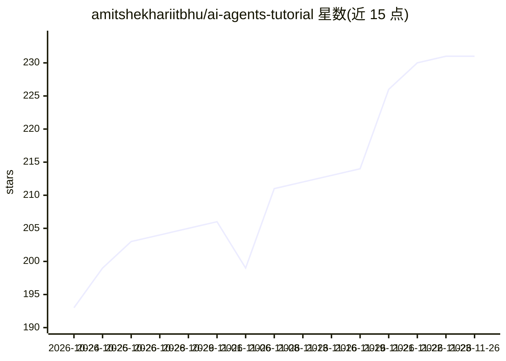

# amitshekhariitbhu/ai-agents-tutorial

⭐ 231 · Apache-2.0 · 推送 2026-11-25 · [GitHub](https://github.com/amitshekhariitbhu/ai-agents-tutorial) · [官网](https://outcomeschool.com/program/ai-and-machine-learning) · 个人维护

**面向开发者的 AI Agent 从零学习教程合集（博客+视频）**

由 Outcome School 创始人 Amit Shekhar 维护的教程系列，按主题组织为博客与视频链接，内容覆盖 AI 工程基础（LLM、RAG、MCP、微调、量化）、函数调用、Agent 循环、ReAct/Reflection/Plan-and-Execute 等模式、Agent 记忆、上下文工程、Agentic RAG、GraphRAG、多智能体系统、子智能体、编排、Agent 通信、计算机使用与浏览器 Agent。作者声明系列会持续扩充，各条目列出所涵盖的子主题清单。

## 筛选速览

| 维度 | 判定 | 备注 |
|---|---|---|
| AI 角色 | `ai-knowledge` | 知识聚合/清单类 |
| 许可风险 | `permissive` | Apache-2.0 |
| 部署形态 | `None` |  |
| 模型依赖 | — | README 未给出锁定关系 |
| 硬件要求 | — | 无带数字的原话,不猜 |
| 安装摩擦 | `low` | 无编译、无系统依赖或容器化 |
| 成熟度 | — | 结构信号不足 |

## 能力要点

- 覆盖从函数调用到多智能体、编排与评测的递进式主题序列
- 每个主题提供博客或视频入口并列出涵盖的子主题
- 包含 ReAct、Reflection、Plan-and-Execute 等具体 Agent 模式的拆解
- 涉及 Agent 记忆、上下文工程、MCP、Agent 通信协议等机制讲解

## 适用场景

- 从零开始系统学习 AI Agent 的概念与工作原理
- 为构建多智能体系统查找编排与通信模式的讲解
- 理解 MCP、函数调用、Agentic RAG 等机制的原理

## 场景标签

`教程课程` · 领域:学习与行业

## 证据(README 行号)

> L5: **Learn AI Agents step by step, from scratch - from function calling to agent loops to multi-agent systems, orchestr
> L7: Prepared and maintained by the **Founder** of Outcome School: Amit Shekhar
> L9: **Note: This series will continue to grow as I write more blogs and create more videos on new topics. Keep learning.

## 星数曲线

2026-10-24 193 → 2026-11-26 231（+38）

---
*卡片 v1 · prompt 1.4 · 生成 2026-11-26 · 置信度 high · 依据 README sha `3a1c24a0e398` · [字段定义](../../DATASET.md)*
