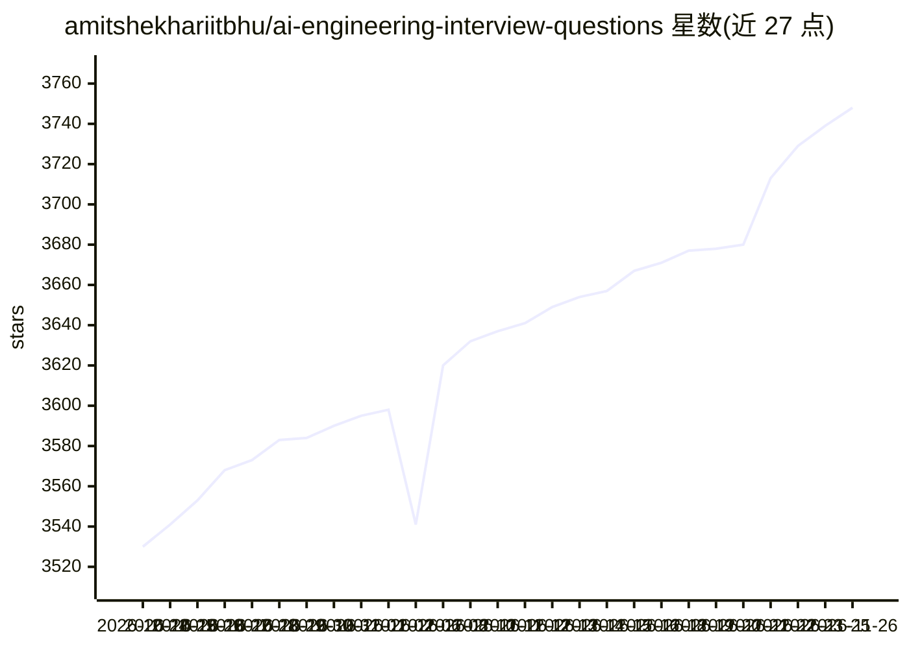

# amitshekhariitbhu/ai-engineering-interview-questions

⭐ 3,748 · Markdown · Apache-2.0 · 推送 2026-11-25 · [GitHub](https://github.com/amitshekhariitbhu/ai-engineering-interview-questions) · [官网](https://outcomeschool.com/program/ai-and-machine-learning) · 个人维护

**面向 AI 工程面试者的问答清单，覆盖 LLM/RAG/Agent 等主题**

以问答清单形式整理 AI 工程岗位面试题：题目按 LLM 基础、Prompt Engineering 等章节组织，多数条目附指向作者视频或文章的答案链接，主题涵盖 Transformer 架构、注意力机制、KV Cache、量化、微调、RLHF/DPO、RAG、MCP、Agent 等。适用角色列表覆盖 AI Engineer、LLM Engineer、MLOps 等 12 类岗位。由 Outcome School 创始人维护，声明持续更新。无安装与运行内容，README 本身即交付物。

## 筛选速览

| 维度 | 判定 | 备注 |
|---|---|---|
| AI 角色 | `ai-knowledge` | 知识聚合/清单类 |
| 许可风险 | `permissive` | Apache-2.0 |
| 部署形态 | `None` |  |
| 模型依赖 | — | README 未给出锁定关系 |
| 硬件要求 | — | 无带数字的原话,不猜 |
| 安装摩擦 | `medium` | 含编译或系统依赖之一 |
| 成熟度 | — | 结构信号不足 |

## 能力要点

- 按 LLM Fundamentals、Prompt Engineering 等章节组织的面试题清单
- 多数题目附作者视频/文章形式的答案链接
- 覆盖 12 类 AI 工程岗位（AI Engineer、LLM Engineer、MLOps 等）
- 主题含 Transformer、KV Cache、量化、微调、RLHF/DPO/GRPO、RAG、MCP、Agent

## 适用场景

- 准备 AI Engineer / LLM Engineer 岗位面试
- 自查 LLM、RAG、Agent、微调等知识盲区
- 按清单查找对应主题的讲解视频与文章

## 场景标签

`教程课程` · 领域:学习与行业

## 证据(README 行号)

> L3: # AI Engineering Interview Questions and Answers
> L46: - LLM
> L55: ### LLM Fundamentals

## 星数曲线

2026-10-24 3,530 → 2026-11-26 3,748（+218）

---
*卡片 v1 · prompt 1.4 · 生成 2026-11-26 · 置信度 high · 依据 README sha `5979ef3227ce` · [字段定义](../../DATASET.md)*
