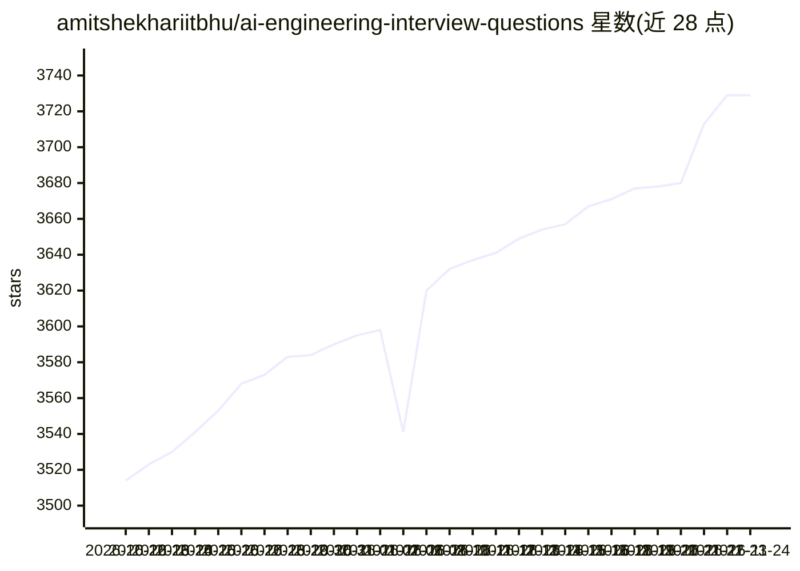

# amitshekhariitbhu/ai-engineering-interview-questions

⭐ 3,729 · Markdown · Apache-2.0 · 推送 2026-11-22 · [GitHub](https://github.com/amitshekhariitbhu/ai-engineering-interview-questions) · [官网](https://outcomeschool.com/program/ai-and-machine-learning) · 个人维护

**AI 工程面试问答清单：面向 AI 工程类岗位的备考资料**

由 Outcome School 创始人维护的 AI 工程面试题库，以问题列表形式组织，答案以外部视频链接给出。可见部分覆盖 LLM 基础（Transformer、注意力机制、tokenization、KV cache、MoE、采样策略）、场景式故障排查题（幻觉、上下文窗口、记忆管理）以及 Prompt Engineering 章节（CoT、ReAct、注入攻击等）。目录还包含 RAG、MCP、Agent、微调、量化等主题；声明会持续更新题目。无代码、无安装步骤，仅问答内容本身。

## 筛选速览

| 维度 | 判定 | 备注 |
|---|---|---|
| AI 角色 | `ai-knowledge` | 知识聚合/清单类 |
| 许可风险 | `permissive` | Apache-2.0 |
| 部署形态 | `None` |  |
| 模型依赖 | — | README 未给出锁定关系 |
| 硬件要求 | — | 无带数字的原话,不猜 |
| 安装摩擦 | `medium` | 含编译或系统依赖之一 |
| 成熟度 | — | 结构信号不足 |

## 能力要点

- 覆盖 LLM 基础、RAG、MCP、Agent、Fine-tuning、量化等主题的问答清单
- 含场景式排查题（幻觉、KV cache 内存、上下文管理）
- 答案以视频讲解链接形式提供
- 面向 11 类 AI 工程相关岗位角色

## 适用场景

- 准备 AI Engineer / LLM Engineer 等岗位面试
- 按主题自查 AI 工程知识盲区
- 查找 Transformer、RLHF、Prompt 工程等概念的讲解视频

## 场景标签

`教程课程` · 领域:学习与行业

## 证据(README 行号)

> L5: > AI Engineering Interview Questions and Answers - Your Cheat Sheet For AI Engineering Interviews
> L44: ### Must Know
> L55: ### LLM Fundamentals

## 星数曲线

2026-10-22 3,514 → 2026-11-24 3,729（+215）

---
*卡片 v1 · prompt 1.4 · 生成 2026-11-23 · 置信度 high · 依据 README sha `80f791890a86` · [字段定义](../../DATASET.md)*
