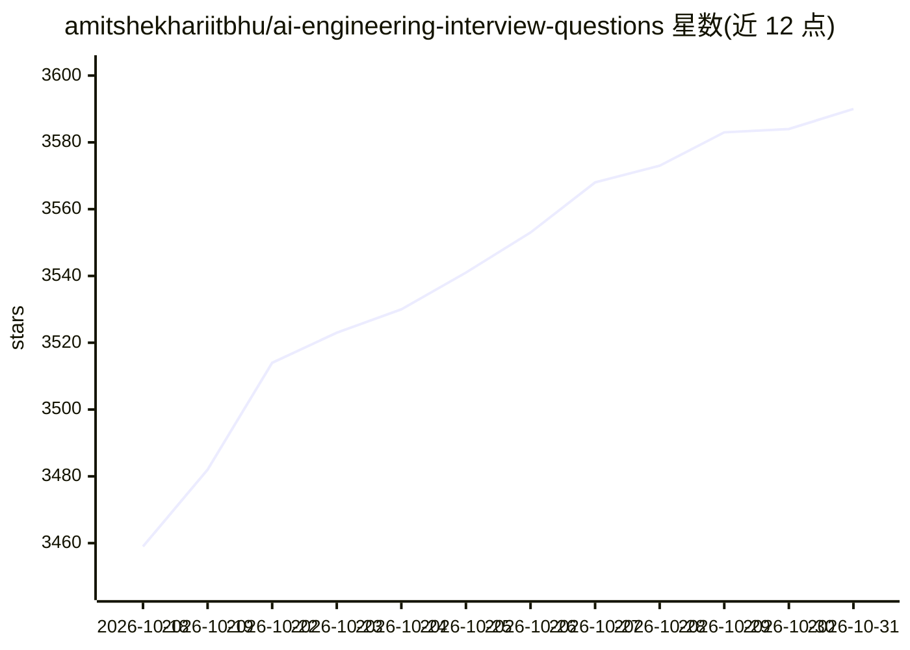

# amitshekhariitbhu/ai-engineering-interview-questions

⭐ 3,590 · Markdown · Apache-2.0 · 推送 2026-10-30 · [GitHub](https://github.com/amitshekhariitbhu/ai-engineering-interview-questions) · [官网](https://outcomeschool.com/program/ai-and-machine-learning) · 个人维护

**AI 工程面试题与答案清单，覆盖 LLM/RAG/Agent 等主题**

由 Amit Shekhar（Outcome School 创始人）维护的 AI 工程面试问答仓库：以条目形式列出面试题，部分附有指向其视频/文章的答案链接。内容按 LLM 基础、提示工程等章节组织，覆盖 Transformer 架构、KV cache、量化、微调、RLHF/PPO/DPO、MCP、Agent 等主题，并包含大量故障排查型情景题。面向 AI Engineer、LLM Engineer、MLOps Engineer 等求职者。以 Markdown 文档形式提供，无需安装运行。

## 筛选速览

| 维度 | 判定 | 备注 |
|---|---|---|
| AI 角色 | `ai-knowledge` | 知识聚合/清单类 |
| 许可风险 | `permissive` | Apache-2.0 |
| 部署形态 | `None` |  |
| 模型依赖 | — | README 未给出锁定关系 |
| 硬件要求 | — | 无带数字的原话,不猜 |
| 安装摩擦 | `medium` | 含编译或系统依赖之一 |
| 成熟度 | — | 结构信号不足 |

## 能力要点

- 按主题分章节的面试题清单（LLM 基础、提示工程等）
- 部分答案以链接形式指向维护者的视频/文章
- 包含大量生产故障排查型情景题（幻觉、上下文超限、prompt 注入等）
- 声明将持续更新内容

## 适用场景

- 准备 AI/LLM 工程岗位面试时按主题刷题
- 系统梳理 LLM 推理优化与提示工程知识点
- 通过情景题了解生产环境常见 LLM 故障与处理思路

## 场景标签

`教程课程` `精选清单` · 领域:学习与行业

## 证据(README 行号)

> L5: > AI Engineering Interview Questions and Answers - Your Cheat Sheet For AI Engineering Interviews
> L57: - What are foundation models, and how have they changed AI engineering?
> L203: - What is prompt engineering, and why is it critical for AI applications?

## 星数曲线

2026-10-18 3,459 → 2026-10-31 3,590（+131）

---
*卡片 v1 · prompt 1.4 · 生成 2026-10-20 · 置信度 high · 依据 README sha `5feb5575c74d` · [字段定义](../../DATASET.md)*
