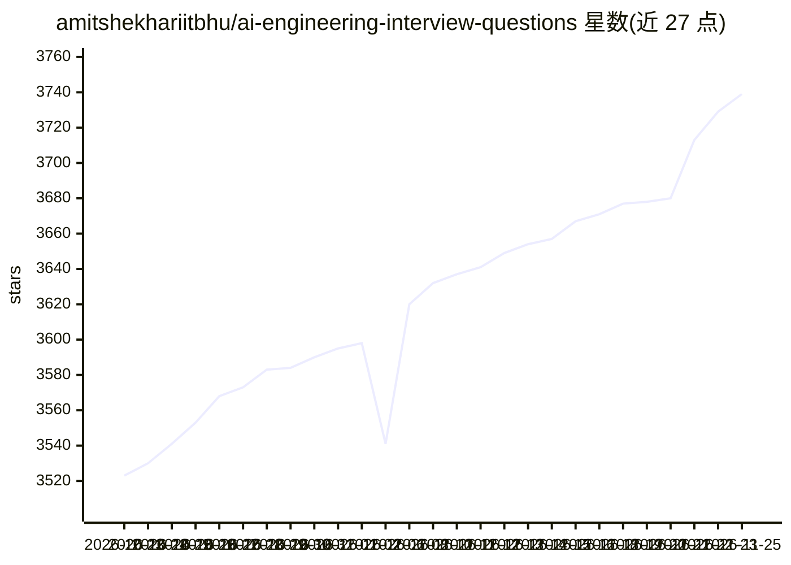

# amitshekhariitbhu/ai-engineering-interview-questions

⭐ 3,739 · Markdown · Apache-2.0 · 推送 2026-11-24 · [GitHub](https://github.com/amitshekhariitbhu/ai-engineering-interview-questions) · [官网](https://outcomeschool.com/program/ai-and-machine-learning) · 个人维护

**面向 AI 工程岗位求职者的面试问答清单**

由 Outcome School 创始人 Amit Shekhar 维护的 AI 工程面试题库，按主题分节收录问题并附答案链接（多为外部视频/文章）。覆盖 LLM 基础（Transformer、tokenization、注意力机制、KV cache、采样策略）、prompt engineering（CoT、ReAct、prompt injection）等，并标注面向 AI Engineer、LLM Engineer、MLOps 等 11 类角色。内容声明持续更新；多数条目以问题列表形式组织，答案指向作者的教学内容。

## 筛选速览

| 维度 | 判定 | 备注 |
|---|---|---|
| AI 角色 | `ai-knowledge` | 知识聚合/清单类 |
| 许可风险 | `permissive` | Apache-2.0 |
| 部署形态 | `None` |  |
| 模型依赖 | — | README 未给出锁定关系 |
| 硬件要求 | — | 无带数字的原话,不猜 |
| 安装摩擦 | `medium` | 含编译或系统依赖之一 |
| 成熟度 | — | 结构信号不足 |

## 能力要点

- 按 LLM Fundamentals、Prompt Engineering 等主题分节的面试问答列表
- 覆盖 Transformer 架构、注意力机制、KV cache、量化、微调等主题
- 标注适用 11 类岗位角色（AI Engineer、LLM Engineer、MLOps 等）
- 答案以链接形式指向作者的视频与文章

## 适用场景

- 准备 AI Engineer / LLM Engineer 岗位面试
- 按主题自查 LLM 基础与 prompt engineering 知识盲区
- 查找特定概念（如 RoPE、GQA、DPO）的讲解资源

## 场景标签

`教程课程` · 领域:学习与行业

## 证据(README 行号)

> L3: # AI Engineering Interview Questions and Answers
> L55: ### LLM Fundamentals
> L206: ### Prompt Engineering

## 星数曲线

2026-10-23 3,523 → 2026-11-25 3,739（+216）

---
*卡片 v1 · prompt 1.4 · 生成 2026-11-24 · 置信度 high · 依据 README sha `4199120dd850` · [字段定义](../../DATASET.md)*
