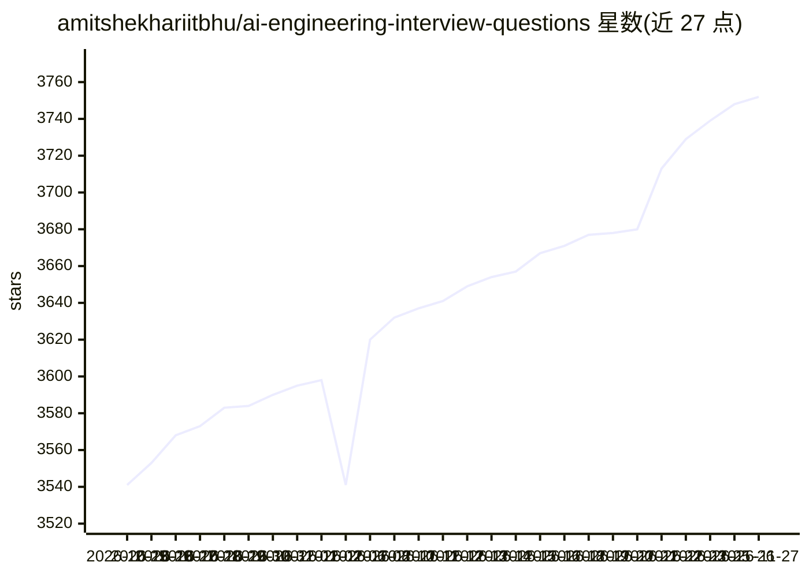

# amitshekhariitbhu/ai-engineering-interview-questions

⭐ 3,752 · Markdown · Apache-2.0 · 推送 2026-11-26 · [GitHub](https://github.com/amitshekhariitbhu/ai-engineering-interview-questions) · [官网](https://outcomeschool.com/program/ai-and-machine-learning) · 个人维护

**AI 工程师面试问答速查表：LLM/RAG/Agent 等题目与答案链接**

由 Outcome School 创始人 Amit Shekhar 维护的 AI 工程面试问答清单，面向 AI Engineer、LLM Engineer、MLOps 等 11 类岗位的准备者。按 LLM Fundamentals、Prompt Engineering 等章节组织问题，覆盖 Transformer 架构、注意力机制、KV Cache、采样策略、RLHF/DPO/GRPO、提示词工程等主题；每题答案以外部文章/视频链接形式提供，仓库本体不含解答正文，作者声明会持续更新。

## 筛选速览

| 维度 | 判定 | 备注 |
|---|---|---|
| AI 角色 | `ai-knowledge` | 知识聚合/清单类 |
| 许可风险 | `permissive` | Apache-2.0 |
| 部署形态 | `None` |  |
| 模型依赖 | — | README 未给出锁定关系 |
| 硬件要求 | — | 无带数字的原话,不猜 |
| 安装摩擦 | `medium` | 含编译或系统依赖之一 |
| 成熟度 | — | 结构信号不足 |

## 能力要点

- 覆盖 11 类 AI 工程相关岗位的面试题清单
- 按 LLM 基础、Prompt Engineering 等主题分章组织
- 每题附作者的文章/视频答案链接
- 含场景式问题（KV Cache 内存估算、幻觉修复、上下文超限处理等）

## 适用场景

- 准备 AI/LLM 工程师岗位的技术面试
- 按清单自查 LLM 基础与提示词工程的知识缺口
- 查找作者讲解 Transformer、RLHF 等主题的文章与视频

## 场景标签

`精选清单` · 领域:学习与行业

## 证据(README 行号)

> L3: # AI Engineering Interview Questions and Answers
> L46: - LLM
> L55: ### LLM Fundamentals

## 星数曲线

2026-10-25 3,541 → 2026-11-27 3,752（+211）

---
*卡片 v1 · prompt 1.4 · 生成 2026-11-27 · 置信度 high · 依据 README sha `463676a60ae3` · [字段定义](../../DATASET.md)*
