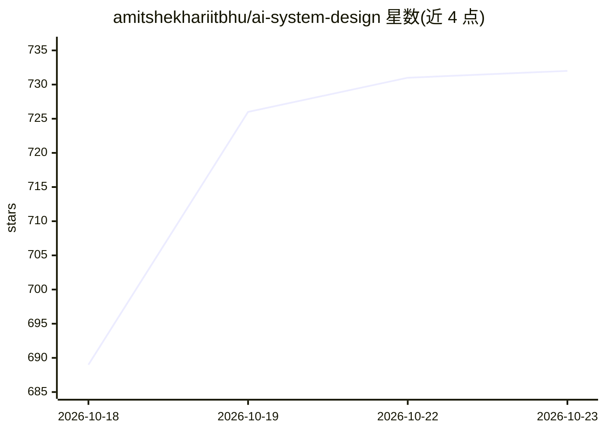

# amitshekhariitbhu/ai-system-design

⭐ 732 · Markdown · Apache-2.0 · 推送 2026-10-22 · [GitHub](https://github.com/amitshekhariitbhu/ai-system-design) · [官网](https://outcomeschool.com/program/ai-and-machine-learning) · 个人维护

**AI 系统设计学习指南：LLM 推理、RAG 与 Agent 的体系化教程**

由 Amit Shekhar（Outcome School 创始人）维护的 AI System Design 教学指南，覆盖 LLM 推理（prefill/decode、KV Cache）、扩展与缓存、RAG 与向量数据库、AI Agent 与多 Agent 系统、MCP、语音 AI、Guardrails、评测与可观测性、成本优化等主题，每个主题链接到深入博客，并提供面试解题框架。面向想转型 AI 工程师的软件工程师、后端开发者、ML 工程师及面试准备者。内容为文档形式，持续更新中，无代码安装步骤。

## 筛选速览

| 维度 | 判定 | 备注 |
|---|---|---|
| AI 角色 | `ai-knowledge` | 知识聚合/清单类 |
| 许可风险 | `permissive` | Apache-2.0 |
| 部署形态 | `None` |  |
| 模型依赖 | — | README 未给出锁定关系 |
| 硬件要求 | — | 无带数字的原话,不猜 |
| 安装摩擦 | `low` | 无编译、无系统依赖或容器化 |
| 成熟度 | — | 结构信号不足 |

## 能力要点

- 覆盖从 LLM 推理机制到 RAG、Agent、评测、成本优化的主题体系
- 每个主题链接到详细博客的深入讲解
- 提供分步骤的 AI System Design 面试解题框架
- 标注面向初学者：术语先解释再使用

## 适用场景

- 系统性学习 AI 系统设计的核心概念与架构模式
- 准备 AI Engineer / GenAI Engineer 系统设计面试
- 作为构建生产级 LLM/RAG/Agent 系统的知识索引

## 场景标签

`教程课程` · 领域:学习与行业

## 证据(README 行号)

> L5: **AI System Design - A complete guide to learn AI System Design step by step - from LLM inference, GPUs, KV Cache, a
> L48: In this guide, we will learn about AI System Design, the discipline of putting GPUs, inference servers, caches, vec

## 星数曲线

2026-10-18 689 → 2026-10-23 732（+43）

---
*卡片 v1 · prompt 1.4 · 生成 2026-10-21 · 置信度 high · 依据 README sha `d0ac5cf78743` · [字段定义](../../DATASET.md)*
