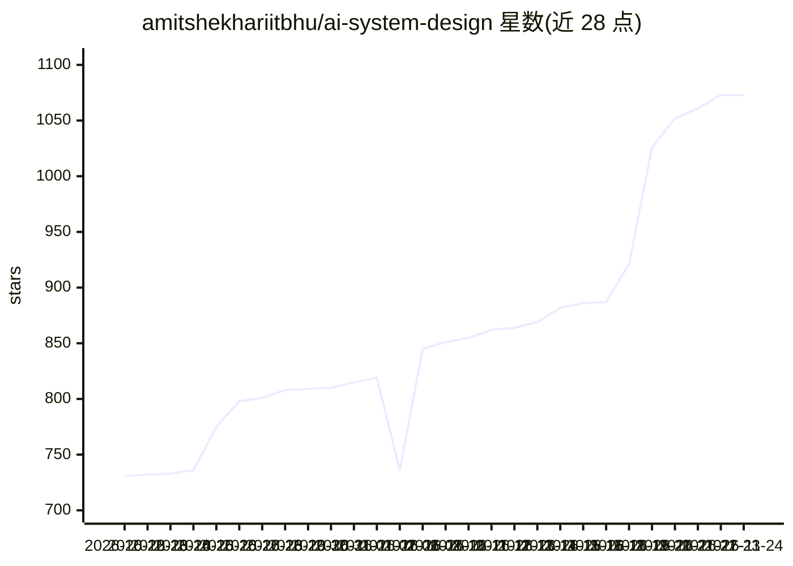

# amitshekhariitbhu/ai-system-design

⭐ 1,073 · Markdown · Apache-2.0 · 推送 2026-11-22 · [GitHub](https://github.com/amitshekhariitbhu/ai-system-design) · [官网](https://outcomeschool.com/program/ai-and-machine-learning) · 个人维护

**AI 系统设计教程：面向工程师分步讲 LLM/RAG/Agent**

由 Outcome School 创始人 Amit Shekhar 撰写并维护的 AI System Design 学习指南，以教程加深度博客链接的形式组织内容，覆盖 GPU 与推理服务器、KV Cache 与缓存、扩展与负载均衡、LLM 路由、RAG、Agent 与多智能体系统、语音 AI、安全护栏、评测、可观测性与成本优化等主题，并附带面试解题框架。面向想转入 AI 工程的软件工程师、后端/移动/前端开发者、ML 工程师及面试备考者。指南声明会持续更新，无代码安装与运行环节。

## 筛选速览

| 维度 | 判定 | 备注 |
|---|---|---|
| AI 角色 | `ai-knowledge` | 知识聚合/清单类 |
| 许可风险 | `permissive` | Apache-2.0 |
| 部署形态 | `None` |  |
| 模型依赖 | — | README 未给出锁定关系 |
| 硬件要求 | — | 无带数字的原话,不猜 |
| 安装摩擦 | `low` | 无编译、无系统依赖或容器化 |
| 成熟度 | — | 结构信号不足 |

## 能力要点

- 按学习路径组织：从 tokens/推理服务器基础到多智能体与推理优化
- 每个主题链接到独立深度博客
- 提供 AI System Design 面试的分步解题框架与案例
- 章节覆盖缓存、路由、RAG、Agent、安全、评测、成本优化等生产主题

## 适用场景

- 准备 AI System Design 或 AI 工程师面试
- 软件工程师转型 AI 工程的系统学习路径
- 了解 LLM 应用在生产环境中的架构组件与权衡

## 场景标签

`教程课程` · 领域:学习与行业

## 证据(README 行号)

> L5: **AI System Design - A complete guide to learn AI System Design step by step - from LLM inference, GPUs, KV Cache, a
> L54: Every section is:
> L85: ## What Will We Learn in This AI System Design Guide?

## 星数曲线

2026-10-22 731 → 2026-11-24 1,073（+342）

---
*卡片 v1 · prompt 1.4 · 生成 2026-11-24 · 置信度 high · 依据 README sha `df697de00f4d` · [字段定义](../../DATASET.md)*
