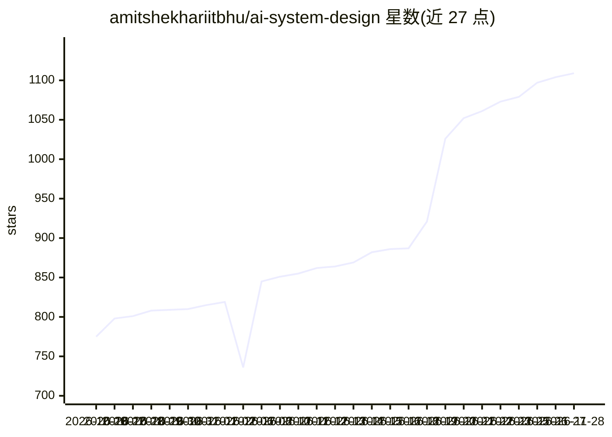

# amitshekhariitbhu/ai-system-design

⭐ 1,109 · Markdown · Apache-2.0 · 推送 2026-11-27 · [GitHub](https://github.com/amitshekhariitbhu/ai-system-design) · [官网](https://outcomeschool.com/program/ai-and-machine-learning) · 个人维护

**面向工程师的 AI 系统设计分步学习指南**

一份按主题组织的 AI System Design 教程仓库，内容覆盖 LLM 推理基础（prefill/decode、TTFT、TPOT）、GPU 与推理引擎选型、KV Cache 与各类缓存、路由、RAG 与向量数据库、AI Agent 与多智能体、语音 AI、guardrails、评测与可观测性、成本优化等，每节配架构图并链接到作者的深度博客。面向想转入 AI 工程方向的软件工程师、面试准备者与技术管理者。README 未提供代码或安装方式，内容随作者博客持续更新。

## 筛选速览

| 维度 | 判定 | 备注 |
|---|---|---|
| AI 角色 | `ai-knowledge` | 知识聚合/清单类 |
| 许可风险 | `permissive` | Apache-2.0 |
| 部署形态 | `None` |  |
| 模型依赖 | — | README 未给出锁定关系 |
| 硬件要求 | — | 无带数字的原话,不猜 |
| 安装摩擦 | `low` | 无编译、无系统依赖或容器化 |
| 成熟度 | — | 结构信号不足 |

## 能力要点

- 覆盖从推理基础到评测、可观测性、成本优化的系统设计主题清单
- 每节提供架构图、真实数字与权衡说明
- 面试框架章节：逐步解题方法与常见面试题
- 各主题链接到作者的深度详解博客

## 适用场景

- 准备 AI System Design 或 AI 工程师岗位面试
- 软件工程师转型 AI 工程方向时系统学习概念
- 将 LLM 应用推向生产前了解缓存、路由、评测等设计要点

## 场景标签

`教程课程` · 领域:学习与行业

## 证据(README 行号)

> L5: **AI System Design - A complete guide to learn AI System Design step by step - from LLM inference, GPUs, KV Cache, a
> L44: ## Table of Contents
> L85: ## What Will We Learn in This AI System Design Guide?

## 星数曲线

2026-10-26 775 → 2026-11-28 1,109（+334）

---
*卡片 v1 · prompt 1.4 · 生成 2026-11-28 · 置信度 high · 依据 README sha `43cff4ebf4f5` · [字段定义](../../DATASET.md)*
