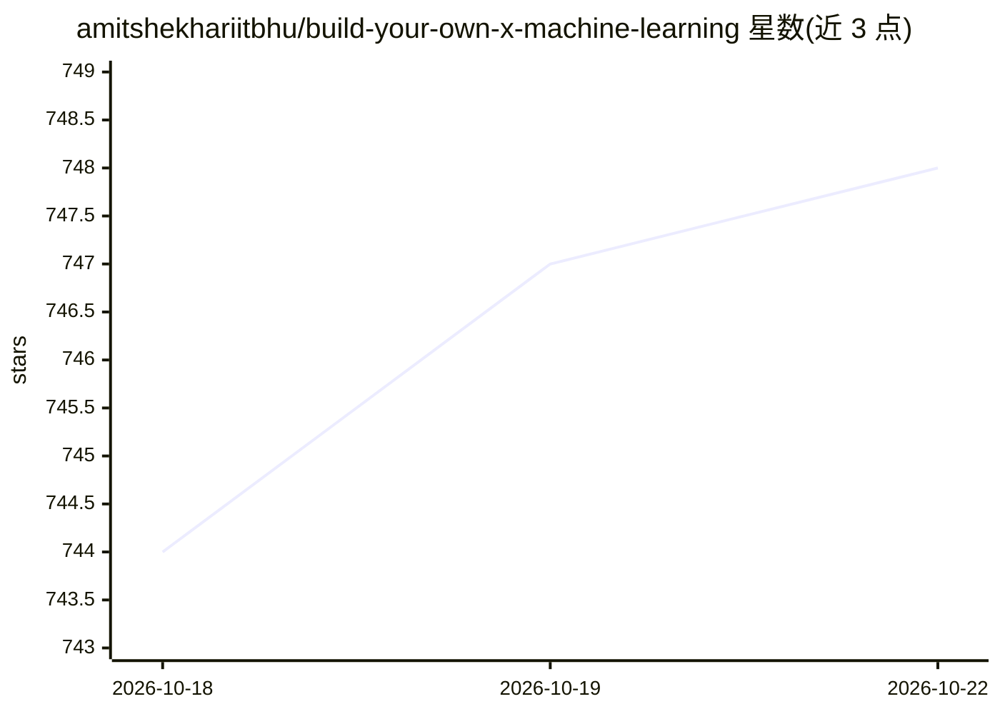

# amitshekhariitbhu/build-your-own-x-machine-learning

⭐ 748 · Python · Apache-2.0 · 推送 2026-07-04 · [GitHub](https://github.com/amitshekhariitbhu/build-your-own-x-machine-learning) · [官网](https://outcomeschool.com) · 个人维护

**机器学习从零实现教程清单：覆盖算法到 LLM 的项目列表**

由 Amit Shekhar（Outcome School 创始人）维护的机器学习项目式学习清单，主题为从零（from scratch）实现各类算法与系统：核心 ML 算法（线性回归、SVM、聚类等）、神经网络与深度学习（含 Transformer LLM、GAN、扩散模型）、推荐系统、计算机视觉、NLP、时间序列预测、异常检测、情感分析及强化学习等杂项应用，条目按类别组织为待构建项目列表。README 未提供安装命令或运行方式，仅注明将持续更新教程。

## 筛选速览

| 维度 | 判定 | 备注 |
|---|---|---|
| AI 角色 | `ai-knowledge` | 知识聚合/清单类 |
| 许可风险 | `permissive` | Apache-2.0 |
| 部署形态 | `None` |  |
| 模型依赖 | — | README 未给出锁定关系 |
| 硬件要求 | — | 无带数字的原话,不猜 |
| 安装摩擦 | `low` | 无编译、无系统依赖或容器化 |
| 成熟度 | — | 结构信号不足 |

## 能力要点

- 覆盖核心 ML 算法、深度学习、LLM 等 10+ 个类别的从零实现条目
- 含推荐系统、计算机视觉、NLP、时间序列等应用方向项目
- 由 Outcome School 创始人维护并持续更新

## 适用场景

- 按清单逐个项目实践以学习机器学习原理
- 查找特定算法或模型（如 BPE 分词器、PPO）的从零实现练习
- 为课程或自学挑选项目式学习题目

## 场景标签

`精选清单` `教程课程` · 领域:学习与行业

## 证据(README 行号)

> L5: > Master machine learning by building everything from scratch. It aims to cover everything from linear regression to
> L33: ### Core Machine Learning Algorithms

## 星数曲线

2026-10-18 744 → 2026-10-22 748（+4）

---
*卡片 v1 · prompt 1.4 · 生成 2026-10-21 · 置信度 high · 依据 README sha `d43bdb7cfc90` · [字段定义](../../DATASET.md)*
