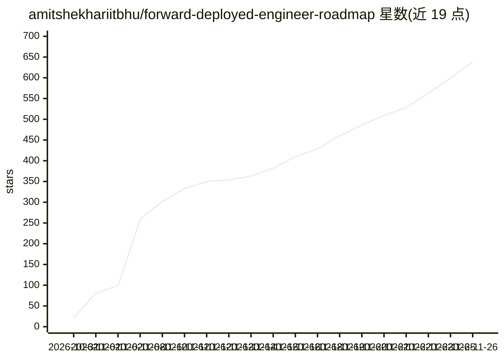

# amitshekhariitbhu/forward-deployed-engineer-roadmap

⭐ 639 · Markdown · Apache-2.0 · 推送 2026-11-25 · [GitHub](https://github.com/amitshekhariitbhu/forward-deployed-engineer-roadmap) · [官网](https://outcomeschool.com/program/ai-and-machine-learning) · 个人维护

**面向工程师成为 AI Forward Deployed Engineer 的分步学习路线图**

由 Outcome School 创始人 Amit Shekhar 维护的教程路线图：按 FDE 与客户协作的生命周期（发现问题→原型→评估→加固→部署）组织为 13 个 Step，每个主题配一篇免费博客及部分视频，覆盖机器学习基础、LLM 原理、模型选型、提示与上下文工程、RAG、AI Agent、评测、安全、推理优化等。纯文档仓库，无代码与安装步骤，声明会持续更新。

## 筛选速览

| 维度 | 判定 | 备注 |
|---|---|---|
| AI 角色 | `ai-knowledge` | 知识聚合/清单类 |
| 许可风险 | `permissive` | Apache-2.0 |
| 部署形态 | `None` |  |
| 模型依赖 | — | README 未给出锁定关系 |
| 硬件要求 | — | 无带数字的原话,不猜 |
| 安装摩擦 | `medium` | 含编译或系统依赖之一 |
| 成熟度 | — | 结构信号不足 |

## 能力要点

- 13 个 Step 按 FDE 参与生命周期排序组织
- 每个主题配免费博客，部分附视频
- 覆盖 RAG、Agent、评测、安全、推理成本等 FDE 宽度知识
- 面向零 AI 背景读者，按序渐进

## 适用场景

- 按路线图系统学习成为 FDE 所需的 AI 工程知识
- 面试 FDE 岗位前按主题查漏补缺
- 为向客户解释 RAG、Agent、微调等概念找入门材料

## 场景标签

`教程课程` · 领域:学习与行业

## 证据(README 行号)

> L5: > Forward Deployed Engineer Roadmap - A step-by-step roadmap to become a Forward Deployed Engineer (FDE) in AI, with
> L66: - Every blog is free to read and is written for beginners. No jargon. No assumptions.

## 星数曲线

2026-10-31 21 → 2026-11-26 639（+618）

---
*卡片 v1 · prompt 1.4 · 生成 2026-11-25 · 置信度 high · 依据 README sha `99824cab88ab` · [字段定义](../../DATASET.md)*
