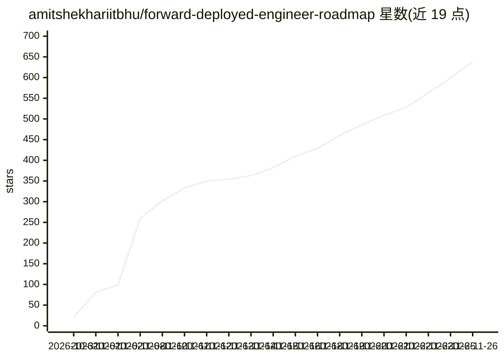

# amitshekhariitbhu/forward-deployed-engineer-roadmap

⭐ 639 · Markdown · Apache-2.0 · 推送 2026-11-25 · [GitHub](https://github.com/amitshekhariitbhu/forward-deployed-engineer-roadmap) · [官网](https://outcomeschool.com/program/ai-and-machine-learning) · 个人维护

**面向 AI Forward Deployed Engineer 岗位的分步学习路线图**

由 Outcome School 创始人 Amit Shekhar 维护的学习路线图，面向想成为 Forward Deployed Engineer（FDE）的工程师。按 FDE 项目生命周期组织为多个步骤（Step 0-13），每步附带免费博客与配套视频，主题涵盖机器学习基础、LLM 原理、模型选型、提示词与上下文工程、RAG、Agent、评测、安全、推理延迟与成本、微调等。声明将持续更新，无需 AI 背景即可按序阅读。

## 筛选速览

| 维度 | 判定 | 备注 |
|---|---|---|
| AI 角色 | `ai-knowledge` | 知识聚合/清单类 |
| 许可风险 | `permissive` | Apache-2.0 |
| 部署形态 | `None` |  |
| 模型依赖 | — | README 未给出锁定关系 |
| 硬件要求 | — | 无带数字的原话,不猜 |
| 安装摩擦 | `medium` | 含编译或系统依赖之一 |
| 成熟度 | — | 结构信号不足 |

## 能力要点

- 按 FDE 项目生命周期（发现→原型→验证→加固→部署）排序的步骤结构
- 每个主题配博客与视频，博客面向初学者且免费阅读
- 主题覆盖 LLM/RAG/Agent/评测/安全/推理优化/微调全链路

## 适用场景

- 想转型做 FDE 岗位的工程师按路线图系统学习
- 准备 FDE 面试前查漏补缺各主题
- 需要在客户现场快速解释 LLM、RAG、Agent 概念时查阅

## 场景标签

`教程课程` · 领域:学习与行业

## 证据(README 行号)

> L5: > Forward Deployed Engineer Roadmap - A step-by-step roadmap to become a Forward Deployed Engineer (FDE) in AI, with
> L46: Almost every FDE engagement follows the same path. This roadmap is ordered to match it.
> L63: - Inside each step, read the blogs in the given order. Every blog explains one concept in simple words with example

## 星数曲线

2026-10-31 21 → 2026-11-26 639（+618）

---
*卡片 v1 · prompt 1.4 · 生成 2026-11-26 · 置信度 high · 依据 README sha `9dda6dd5c6fa` · [字段定义](../../DATASET.md)*
