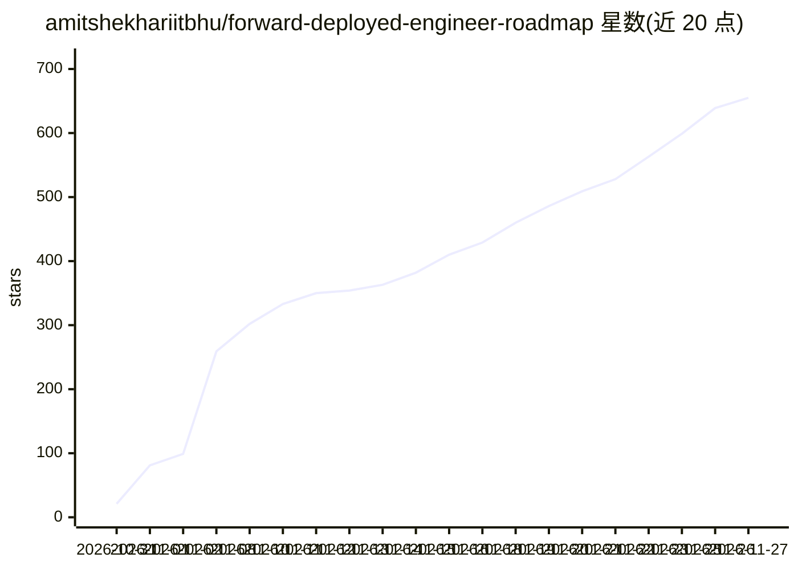

# amitshekhariitbhu/forward-deployed-engineer-roadmap

⭐ 655 · Markdown · Apache-2.0 · 推送 2026-11-26 · [GitHub](https://github.com/amitshekhariitbhu/forward-deployed-engineer-roadmap) · [官网](https://outcomeschool.com/program/ai-and-machine-learning) · 个人维护

**面向想成为 AI 前置部署工程师者的分步学习路线图（配博客）**

由 Outcome School 创始人 Amit Shekhar 维护的学习路线图，按 FDE 参与生命周期（发现问题→原型→评测→加固→部署）组织为 14 个步骤，每步列出免费博客与配套视频，覆盖机器学习基础、LLM 原理、模型选型、提示与上下文工程、RAG、Agent、评测、安全、推理延迟与成本等主题。面向零 AI 背景也可按序阅读的读者，内容持续更新；仓库本身不包含代码或工具，仅聚合教学文章。

## 筛选速览

| 维度 | 判定 | 备注 |
|---|---|---|
| AI 角色 | `ai-knowledge` | 知识聚合/清单类 |
| 许可风险 | `permissive` | Apache-2.0 |
| 部署形态 | `None` |  |
| 模型依赖 | — | README 未给出锁定关系 |
| 硬件要求 | — | 无带数字的原话,不猜 |
| 安装摩擦 | `medium` | 含编译或系统依赖之一 |
| 成熟度 | — | 结构信号不足 |

## 能力要点

- 按 FDE 参与生命周期（Discover→Prototype→Prove→Harden→Deploy）排序的 14 步路线
- 每个主题配套免费博客与视频，面向零基础读者
- 覆盖 LLM、RAG、Agent、评测、安全、推理优化等 FDE 宽度知识面

## 适用场景

- 想转做 Forward Deployed Engineer 的工程师按步骤系统学习
- 准备 FDE 面试前查漏补缺各 AI 工程主题
- 了解 FDE 在客户现场的工作流程与所需技能

## 场景标签

`教程课程` · 领域:学习与行业

## 证据(README 行号)

> L5: > Forward Deployed Engineer Roadmap - A step-by-step roadmap to become a Forward Deployed Engineer (FDE) in AI, with
> L63: - Inside each step, read the blogs in the given order. Every blog explains one concept in simple words with example
> L66: - Every blog is free to read and is written for beginners. No jargon. No assumptions.

## 星数曲线

2026-10-31 21 → 2026-11-27 655（+634）

---
*卡片 v1 · prompt 1.4 · 生成 2026-11-27 · 置信度 high · 依据 README sha `2c42190fc2c2` · [字段定义](../../DATASET.md)*
