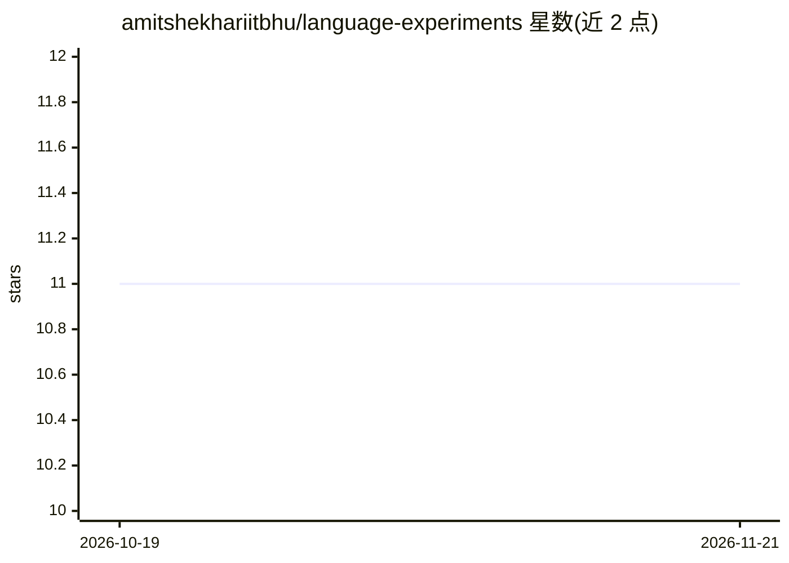

# amitshekhariitbhu/language-experiments

⭐ 11 · C++ · MIT · 推送 2026-03-10 · [GitHub](https://github.com/amitshekhariitbhu/language-experiments) · [官网](https://outcomeschool.com) · 个人维护

**编程语言实验知识库：10 种语言 100 个揭示反直觉行为的脚本**

按语言分文件夹组织的可运行实验合集，覆盖 C/C++/Go/Java/JavaScript/Kotlin/Python/Ruby/Rust/Swift 共 10 种语言，每种 10 个独立实验脚本，每个脚本演示一个非显而易见的语言行为，发现记录在各语言的 INSIGHTS.md 中（What/Expected/Actual/Why 结构）。README 明确声明所有实验与洞见由 LLM 生成，需自行验证。扩展方式为在 Claude Code 中打开项目，由 agent 读取已有实验、生成并运行新脚本后追加发现；实验也可用对应语言解释器手动运行。MIT 许可，无安装步骤。

## 筛选速览

| 维度 | 判定 | 备注 |
|---|---|---|
| AI 角色 | `ai-knowledge` | 知识聚合/清单类 |
| 许可风险 | `permissive` | MIT |
| 部署形态 | `None` |  |
| 模型依赖 | — | README 未给出锁定关系 |
| 硬件要求 | — | 无带数字的原话,不猜 |
| 安装摩擦 | `low` | 无编译、无系统依赖或容器化 |
| 成熟度 | — | 结构信号不足 |

## 能力要点

- 100 个实验覆盖 10 种语言，每种语言独立文件夹
- INSIGHTS.md 以 What/Expected/Actual/Why 结构记录发现
- agent 生成新实验前读取已有实验以避免重复，并运行验证输出
- 实验脚本独立可运行，也可手动执行

## 适用场景

- 学习某语言在边界情况下的真实运行行为
- 在 Claude Code 中让 agent 继续扩展某个语言主题的实验
- 对照预期与实际输出理解语言设计细节

## 场景标签

`教程课程` · 领域:学习与行业

## 证据(README 行号)

> L3: AI Agent to deepen your understanding of programming languages through experiments.
> L9: > **Note:** All experiments and insights are LLM-generated. Always verify the explanations and run the experiments y
> L13: This project comes with **100 experiments** across 10 languages (10 per language). Each language folder contains ru

## 星数曲线

2026-10-19 11 → 2026-11-21 11（+0）

---
*卡片 v1 · prompt 1.4 · 生成 2026-11-18 · 置信度 high · 依据 README sha `f264f27ffa9c` · [字段定义](../../DATASET.md)*
