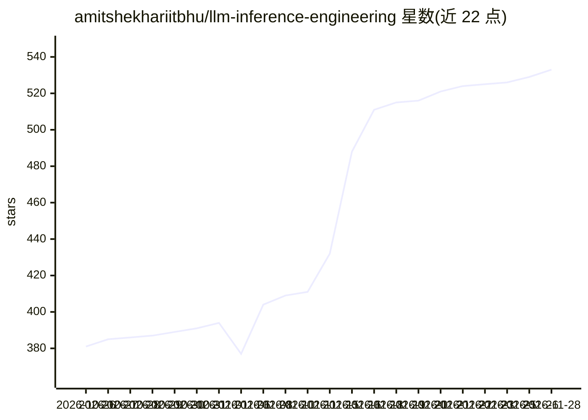

# amitshekhariitbhu/llm-inference-engineering

⭐ 533 · Markdown · Apache-2.0 · 推送 2026-11-09 · [GitHub](https://github.com/amitshekhariitbhu/llm-inference-engineering) · [官网](https://outcomeschool.com/program/ai-and-machine-learning) · 个人维护

**面向工程师的 LLM 推理工程系列教程：从 KV cache 到推理引擎**

由 Outcome School 创始人 Amit Shekhar 维护的博客/视频教程清单，按四部分组织 LLM 推理工程知识：基础（自回归模型、Prefill/Decode 两阶段、Prefill-Decode 分离）、内存与注意力优化（KV Cache 及压缩、GPU 显存计算、Paged Attention、Flash Attention、GQA）、吞吐与延迟（Continuous Batching、Speculative Decoding、Medusa、EAGLE、N-gram 推测、Token Streaming、Prompt Caching）以及引擎与格式。README 为目录形式，每篇以要点列表概括并链接到正文，内容持续更新。

## 筛选速览

| 维度 | 判定 | 备注 |
|---|---|---|
| AI 角色 | `ai-knowledge` | 知识聚合/清单类 |
| 许可风险 | `permissive` | Apache-2.0 |
| 部署形态 | `None` |  |
| 模型依赖 | — | README 未给出锁定关系 |
| 硬件要求 | — | 无带数字的原话,不猜 |
| 安装摩擦 | `medium` | 含编译或系统依赖之一 |
| 成熟度 | — | 结构信号不足 |

## 能力要点

- 覆盖 KV Cache、Paged Attention、Flash Attention、GQA 等内存与注意力优化主题
- 涵盖 Speculative Decoding 家族（Medusa、EAGLE、N-gram 推测）与 Continuous Batching
- 介绍 TTFT、TPOT、吞吐量等推理性能指标及各阶段优化技术
- 以博客+视频形式持续更新，附每篇要点大纲

## 适用场景

- 系统学习 LLM 推理优化从基础到引擎层的知识
- 为推理服务选型前理解 KV cache、批处理与推测解码原理
- 排查 GPU 显存占用与延迟问题前补充背景知识

## 场景标签

`教程课程` · 领域:学习与行业

## 证据(README 行号)

> L3: # LLM Inference Engineering
> L5: **Learn LLM Inference Engineering step by step - from KV cache, PagedAttention, and continuous batching to vLLM, SGL
> L7: Prepared and maintained by the **Founder** of Outcome School: Amit Shekhar

## 星数曲线

2026-10-26 381 → 2026-11-28 533（+152）

---
*卡片 v1 · prompt 1.4 · 生成 2026-11-25 · 置信度 high · 依据 README sha `cc7abc592c87` · [字段定义](../../DATASET.md)*
