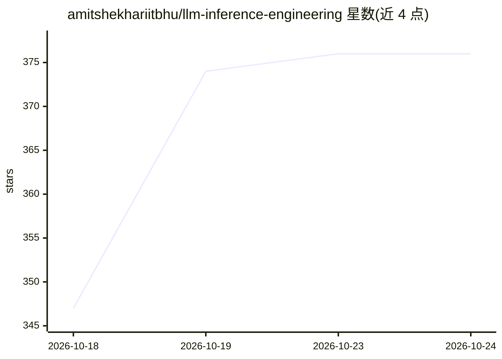

# amitshekhariitbhu/llm-inference-engineering

⭐ 376 · Markdown · Apache-2.0 · 推送 2026-10-05 · [GitHub](https://github.com/amitshekhariitbhu/llm-inference-engineering) · [官网](https://outcomeschool.com/program/ai-and-machine-learning) · 个人维护

**LLM 推理工程系列教程：逐步讲解 KV cache、批处理与推理引擎**

由 Amit Shekhar（Outcome School 创始人）维护的 LLM 推理工程学习教程仓库，以博客/视频系列形式按四部分组织：推理基础（自回归模型、Prefill vs Decode、预填充-解码分离）、内存与注意力优化（KV Cache、PagedAttention、Flash Attention、GQA）、吞吐与延迟（连续批处理、投机解码、Medusa、EAGLE、N-gram 投机、Token 流式、Prompt 缓存）、引擎与格式（vLLM 等）。条目列出各篇博客覆盖的知识点，不提供代码安装或运行方式。

## 筛选速览

| 维度 | 判定 | 备注 |
|---|---|---|
| AI 角色 | `ai-knowledge` | 知识聚合/清单类 |
| 许可风险 | `permissive` | Apache-2.0 |
| 部署形态 | `None` |  |
| 模型依赖 | — | README 未给出锁定关系 |
| 硬件要求 | — | 无带数字的原话,不猜 |
| 安装摩擦 | `medium` | 含编译或系统依赖之一 |
| 成熟度 | — | 结构信号不足 |

## 能力要点

- 四部分递进组织：基础→内存/注意力优化→吞吐与延迟→引擎与格式
- 覆盖 KV Cache、PagedAttention、Flash Attention 1-3、GQA、连续批处理等主题
- 投机解码系列含 Medusa、EAGLE、N-gram Speculation 等多篇专题

## 适用场景

- 系统学习 LLM 推理优化技术及其原理
- 了解 vLLM、SGLang 等推理引擎的工作机制
- 为推理工程面试或工程实践梳理知识框架

## 场景标签

`教程课程` · 领域:学习与行业

## 证据(README 行号)

> L3: # LLM Inference Engineering
> L5: **Learn LLM Inference Engineering step by step - from KV cache, PagedAttention, and continuous batching to vLLM, SGL
> L295: These optimizations come together inside real serving engines and model formats. Let's see how the most important 

## 星数曲线

2026-10-18 347 → 2026-10-24 376（+29）

---
*卡片 v1 · prompt 1.4 · 生成 2026-10-22 · 置信度 high · 依据 README sha `4e0636279f6b` · [字段定义](../../DATASET.md)*
