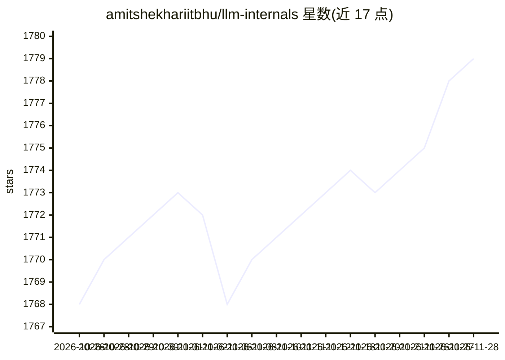

# amitshekhariitbhu/llm-internals

⭐ 1,779 · Apache-2.0 · 推送 2026-11-26 · [GitHub](https://github.com/amitshekhariitbhu/llm-internals) · [官网](https://outcomeschool.com/program/ai-and-machine-learning) · 个人维护

**面向工程师的 LLM 原理系列教程（博客+视频索引）**

由 Outcome School 创始人 Amit Shekhar 维护的 LLM 内部原理学习索引，按主题组织为一系列博客与视频的目录：涵盖 LLM 工作流程、tokenization 与 BPE、Stop Token、Attention 的 Q/K/V 数学、√dₖ 缩放、因果掩码、反向传播与交叉熵损失、logprobs、约束解码、Transformer 架构、FFN、归一化、KV Cache 与 Paged Attention。README 本身不包含完整教学内容，仅提供各篇的目录说明与入口链接，且声明系列会持续扩充。

## 筛选速览

| 维度 | 判定 | 备注 |
|---|---|---|
| AI 角色 | `ai-knowledge` | 知识聚合/清单类 |
| 许可风险 | `permissive` | Apache-2.0 |
| 部署形态 | `None` |  |
| 模型依赖 | — | README 未给出锁定关系 |
| 硬件要求 | — | 无带数字的原话,不猜 |
| 安装摩擦 | `low` | 无编译、无系统依赖或容器化 |
| 成熟度 | — | 结构信号不足 |

## 能力要点

- 按主题组织的系列博客/视频索引，从 tokenization 到推理优化
- 每篇附详细知识点清单（如 BPE 步骤、注意力公式推导）
- 含逐步数值示例的数学讲解（注意力、反向传播、交叉熵）
- 覆盖 KV Cache 与 Paged Attention 等推理优化主题

## 适用场景

- 系统学习 LLM 从分词到推理优化的内部原理
- 理解注意力机制背后的数学推导
- 查阅 KV Cache、约束解码等概念的教学材料

## 场景标签

`教程课程` · 领域:学习与行业

## 证据(README 行号)

> L5: **Learn LLM internals step by step - from tokenization to attention to inference optimization.**
> L7: Prepared and maintained by the **Founder** of Outcome School: Amit Shekhar
> L9: **Note: This series will continue to grow as I write more blogs and create more videos on new topics. Keep learning.

## 星数曲线

2026-10-26 1,768 → 2026-11-28 1,779（+11）

---
*卡片 v1 · prompt 1.4 · 生成 2026-11-27 · 置信度 high · 依据 README sha `26d5af3d6388` · [字段定义](../../DATASET.md)*
