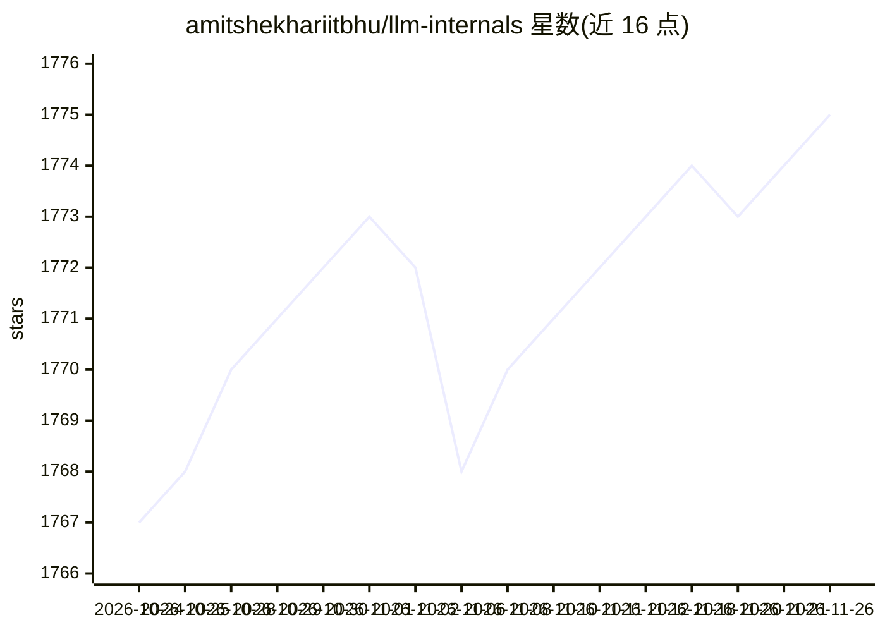

# amitshekhariitbhu/llm-internals

⭐ 1,775 · Apache-2.0 · 推送 2026-11-22 · [GitHub](https://github.com/amitshekhariitbhu/llm-internals) · [官网](https://outcomeschool.com/program/ai-and-machine-learning) · 个人维护

**面向开发者的 LLM 内部原理系列教程（分词→注意力→推理优化）**

由 Outcome School 创始人 Amit Shekhar 编写的 LLM 原理学习资料索引，以博客与视频形式逐步讲解分词、BPE、注意力机制（Q/K/V 数学、√dₖ 缩放、因果掩码）、Transformer 架构、反向传播与交叉熵损失、KV Cache、Paged Attention、Flash Attention 等主题，每篇附带 covered 目录。仓库本身不含可运行代码产品，内容持续增长中，定位为系统学习 LLM 内部机制的教程集合。

## 筛选速览

| 维度 | 判定 | 备注 |
|---|---|---|
| AI 角色 | `ai-knowledge` | 知识聚合/清单类 |
| 许可风险 | `permissive` | Apache-2.0 |
| 部署形态 | `None` |  |
| 模型依赖 | — | README 未给出锁定关系 |
| 硬件要求 | — | 无带数字的原话,不猜 |
| 安装摩擦 | `low` | 无编译、无系统依赖或容器化 |
| 成熟度 | — | 结构信号不足 |

## 能力要点

- 覆盖从 tokenization 到 attention 再到推理优化（KV Cache/Paged Attention/Flash Attention）的系列文章与视频
- 注意力 Q/K/V、√dₖ 缩放、因果掩码均附逐步数值示例
- 包含反向传播与交叉熵损失的数学推导与 Python 实现
- 每篇列出详细 covered 目录便于按主题检索

## 适用场景

- 系统学习 LLM 从分词到推理优化的内部原理
- 通过数值示例理解注意力与反向传播的数学细节
- 为团队培训寻找 LLM 基础教学材料

## 场景标签

`教程课程` · 领域:学习与行业

## 证据(README 行号)

> L5: **Learn LLM internals step by step - from tokenization to attention to inference optimization.**
> L7: Prepared and maintained by the **Founder** of Outcome School: Amit Shekhar

## 星数曲线

2026-10-24 1,767 → 2026-11-26 1,775（+8）

---
*卡片 v1 · prompt 1.4 · 生成 2026-11-23 · 置信度 high · 依据 README sha `b42f6e9fcdbd` · [字段定义](../../DATASET.md)*
