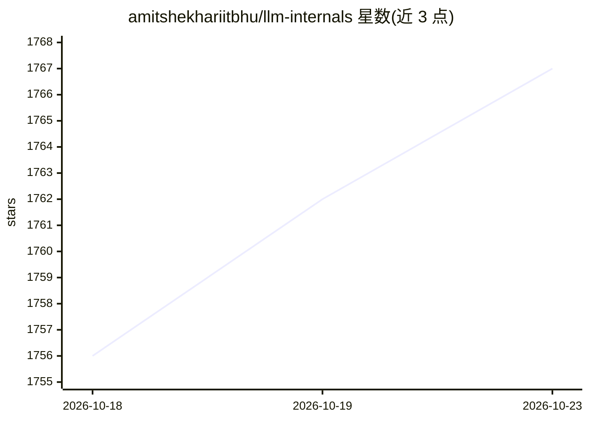

# amitshekhariitbhu/llm-internals

⭐ 1,767 · Apache-2.0 · 推送 2026-10-14 · [GitHub](https://github.com/amitshekhariitbhu/llm-internals) · [官网](https://outcomeschool.com/program/ai-and-machine-learning) · 个人维护

**LLM 内部原理的分步学习资源清单（博客+视频）**

由 Outcome School 创始人 Amit Shekhar 维护的 LLM 原理学习内容索引：以博客与视频条目形式覆盖分词与 BPE、Stop Tokens、Attention 数学（Q/K/V、√dₖ 缩放、因果掩码）、反向传播、交叉熵损失、Transformer 架构、KV Cache、Paged Attention、Flash Attention、投机解码与 Medusa 等主题。README 本身不提供代码安装或运行方式，每条目附博客/视频链接，作者声明系列将持续更新。

## 筛选速览

| 维度 | 判定 | 备注 |
|---|---|---|
| AI 角色 | `ai-knowledge` | 知识聚合/清单类 |
| 许可风险 | `permissive` | Apache-2.0 |
| 部署形态 | `None` |  |
| 模型依赖 | — | README 未给出锁定关系 |
| 硬件要求 | — | 无带数字的原话,不猜 |
| 安装摩擦 | `low` | 无编译、无系统依赖或容器化 |
| 成熟度 | — | 结构信号不足 |

## 能力要点

- 从分词到注意力机制再到推理优化的分步主题覆盖
- 含 KV Cache、Paged Attention、Flash Attention、投机解码等推理优化专题
- 数学专题（Q/K/V、√dₖ、反向传播、交叉熵）配逐步数值示例

## 适用场景

- 系统学习 LLM 从分词到推理优化的内部原理
- 查找 Attention、KV Cache、Flash Attention 等专题的讲解材料
- 作为 AI 面试或自学的主题路线图

## 场景标签

`精选清单` · 领域:学习与行业

## 证据(README 行号)

> L5: **Learn LLM internals step by step - from tokenization to attention to inference optimization.**
> L9: **Note: This series will continue to grow as I write more blogs and create more videos on new topics. Keep learning.

## 星数曲线

2026-10-18 1,756 → 2026-10-23 1,767（+11）

---
*卡片 v1 · prompt 1.4 · 生成 2026-10-21 · 置信度 high · 依据 README sha `7e52bc9af714` · [字段定义](../../DATASET.md)*
