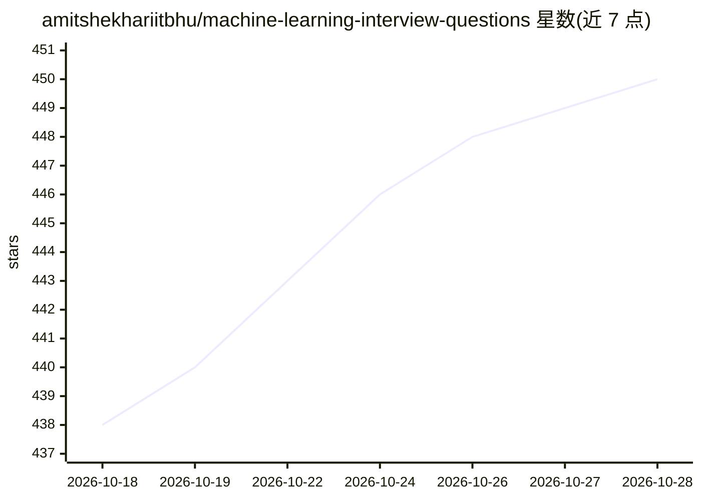

# amitshekhariitbhu/machine-learning-interview-questions

⭐ 450 · Markdown · Apache-2.0 · 推送 2026-10-27 · [GitHub](https://github.com/amitshekhariitbhu/machine-learning-interview-questions) · [官网](https://outcomeschool.com/program/ai-and-machine-learning) · 个人维护

**机器学习面试题与答案的备考清单**

由 Amit Shekhar（Outcome School 创始人）维护的机器学习/AI 面试问答清单，覆盖 ML 基础、算法、数据预处理与特征工程、优化、深度学习、NLP、计算机视觉、大语言模型等主题，并链接到 AI Engineering（LLM、RAG、MCP、Agent、微调、量化）问答。部分条目附带答案链接（文章或视频），README 声明将持续更新。条目形式为问题列表加答案链接，非可运行的软件。

## 筛选速览

| 维度 | 判定 | 备注 |
|---|---|---|
| AI 角色 | `ai-knowledge` | 知识聚合/清单类 |
| 许可风险 | `permissive` | Apache-2.0 |
| 部署形态 | `None` |  |
| 模型依赖 | — | README 未给出锁定关系 |
| 硬件要求 | — | 无带数字的原话,不猜 |
| 安装摩擦 | `low` | 无编译、无系统依赖或容器化 |
| 成熟度 | — | 结构信号不足 |

## 能力要点

- 覆盖 ML 基础/算法/优化/深度学习/NLP/CV/LLM 等多个主题分区
- 面向 AI Engineer、MLOps、数据科学家等多种角色
- 部分条目附答案链接（文章/视频）
- 维护方声明持续更新内容

## 适用场景

- 我准备机器学习或 AI 工程岗面试时按主题刷题
- 我系统性复习深度学习、NLP、计算机视觉的常考概念
- 我准备 AI Engineering（LLM/RAG/Agent）方向的面试

## 场景标签

`精选清单` · 领域:学习与行业

## 证据(README 行号)

> L3: # Machine Learning Interview Questions and Answers
> L7: > These interview questions and answers are helpful for roles such as:
> L15: ## Table of Contents

## 星数曲线

2026-10-18 438 → 2026-10-28 450（+12）

---
*卡片 v1 · prompt 1.4 · 生成 2026-10-21 · 置信度 high · 依据 README sha `b76ab2010ba5` · [字段定义](../../DATASET.md)*
