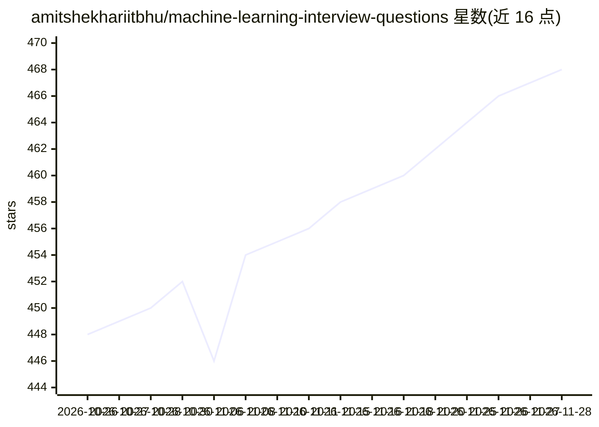

# amitshekhariitbhu/machine-learning-interview-questions

⭐ 468 · Markdown · Apache-2.0 · 推送 2026-11-27 · [GitHub](https://github.com/amitshekhariitbhu/machine-learning-interview-questions) · [官网](https://outcomeschool.com/program/ai-and-machine-learning) · 个人维护

**机器学习面试题与答案清单：覆盖AI工程师等岗位备考**

由 Outcome School 创始人 Amit Shekhar 维护的面试问答清单，面向 AI Engineer、Gen AI Engineer、MLOps Engineer、Machine Learning Engineer、Data Scientist、Deep Learning Engineer 等岗位的面试准备。内容按主题组织：AI Engineering（LLM、RAG、MCP、Agent、Fine-tuning、Quantization）、机器学习基础、算法、数据预处理与特征工程、优化、深度学习；每个问题附外部文章形式的答案链接，作者声明持续更新新增问答。

## 筛选速览

| 维度 | 判定 | 备注 |
|---|---|---|
| AI 角色 | `ai-knowledge` | 知识聚合/清单类 |
| 许可风险 | `permissive` | Apache-2.0 |
| 部署形态 | `None` |  |
| 模型依赖 | — | README 未给出锁定关系 |
| 硬件要求 | — | 无带数字的原话,不猜 |
| 安装摩擦 | `low` | 无编译、无系统依赖或容器化 |
| 成熟度 | — | 结构信号不足 |

## 能力要点

- 覆盖 AI Engineering 主题：LLM、RAG、MCP、Agent、Fine-tuning、Quantization
- 问题按基础、算法、特征工程、优化、深度学习分类组织
- 每个问题附作者撰写的答案文章链接
- 作者声明持续更新新增问答

## 适用场景

- 准备机器学习/深度学习工程师岗位面试
- 复习监督学习、正则化、优化器等基础概念
- 了解 Transformer、VAE、GAN 等架构的常见面试问法

## 场景标签

`精选清单` · 领域:学习与行业

## 证据(README 行号)

> L3: # Machine Learning Interview Questions and Answers
> L40: ### AI Engineering

## 星数曲线

2026-10-26 448 → 2026-11-28 468（+20）

---
*卡片 v1 · prompt 1.4 · 生成 2026-11-28 · 置信度 high · 依据 README sha `7a82e30ddf47` · [字段定义](../../DATASET.md)*
