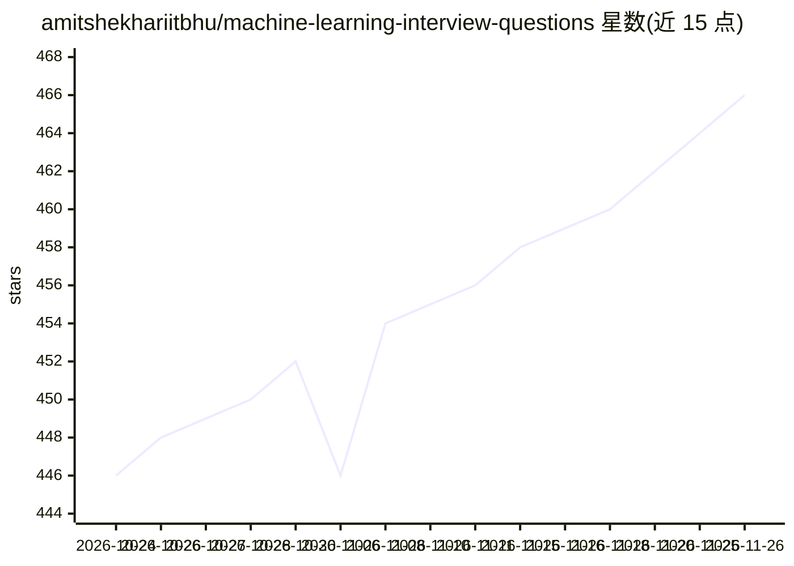

# amitshekhariitbhu/machine-learning-interview-questions

⭐ 466 · Markdown · Apache-2.0 · 推送 2026-11-25 · [GitHub](https://github.com/amitshekhariitbhu/machine-learning-interview-questions) · [官网](https://outcomeschool.com/program/ai-and-machine-learning) · 个人维护

**机器学习面试问答速查表，覆盖 LLM 到深度学习**

由 Outcome School 创始人 Amit Shekhar 维护的机器学习面试问答清单，按 AI Engineering、机器学习基础、算法、数据预处理与特征工程、优化、深度学习等主题组织问题，多数问题附带指向其博客文章的答案链接；覆盖 LLM、RAG、MCP、Agent、微调、量化等 AI 工程话题，以及 Transformer、VAE、GAN 等深度学习内容。README 声明会持续更新新问题和答案。纯文档型仓库，无安装或运行步骤。

## 筛选速览

| 维度 | 判定 | 备注 |
|---|---|---|
| AI 角色 | `ai-knowledge` | 知识聚合/清单类 |
| 许可风险 | `permissive` | Apache-2.0 |
| 部署形态 | `None` |  |
| 模型依赖 | — | README 未给出锁定关系 |
| 硬件要求 | — | 无带数字的原话,不猜 |
| 安装摩擦 | `low` | 无编译、无系统依赖或容器化 |
| 成熟度 | — | 结构信号不足 |

## 能力要点

- 按 AI Engineering/机器学习基础/算法/特征工程/优化/深度学习分类的问题清单
- 多数问题附指向博客文章的答案链接
- 涵盖 LLM、RAG、MCP、Agent、微调、量化等 AI 工程话题
- 声明持续更新问题与答案

## 适用场景

- 准备 AI 工程师、ML 工程师、数据科学家等岗位的面试
- 按主题查漏补缺机器学习与深度学习概念
- 通过答案链接深入阅读具体知识点

## 场景标签

`教程课程` · 领域:学习与行业

## 证据(README 行号)

> L3: # Machine Learning Interview Questions and Answers
> L5: > Machine Learning Interview Questions and Answers - Your Cheat Sheet For Machine Learning Interview
> L17: ### Prepared and maintained by the **Founder** of Outcome School: Amit Shekhar

## 星数曲线

2026-10-24 446 → 2026-11-26 466（+20）

---
*卡片 v1 · prompt 1.4 · 生成 2026-11-26 · 置信度 high · 依据 README sha `9a9184104fec` · [字段定义](../../DATASET.md)*
