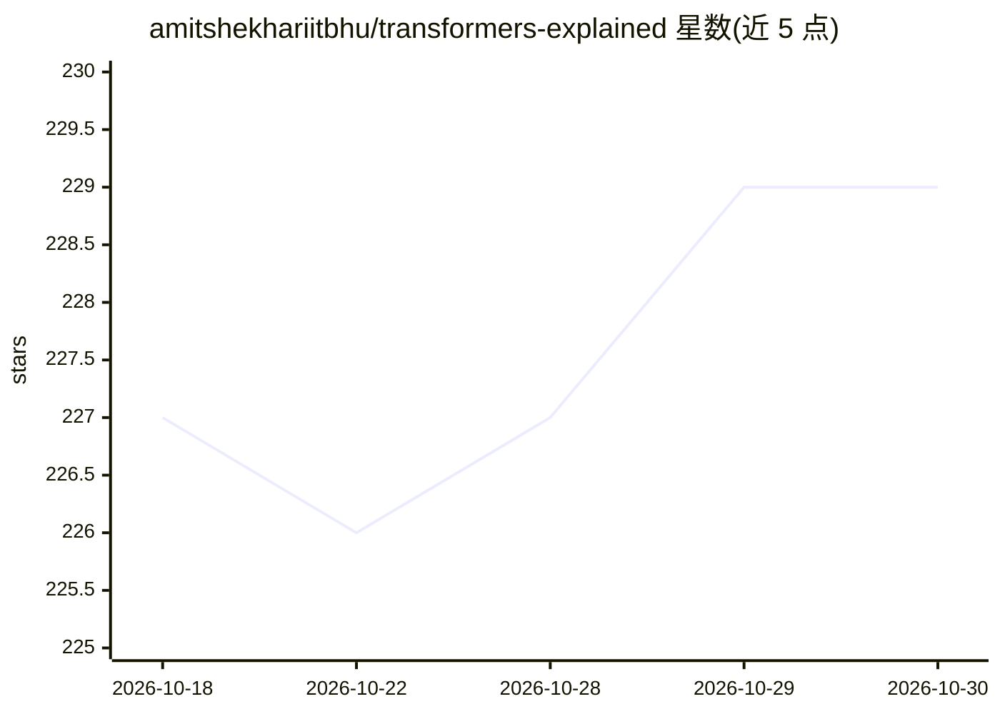

# amitshekhariitbhu/transformers-explained

⭐ 229 · Apache-2.0 · 推送 2026-07-08 · [GitHub](https://github.com/amitshekhariitbhu/transformers-explained) · [官网](https://outcomeschool.com/program/ai-and-machine-learning) · 个人维护

**逐步讲解 Transformer 架构的博客/视频教程合集**

由 Amit Shekhar（Outcome School 创始人）维护的 Transformer 架构教程合集，按五部分组织：整体架构、注意力机制（Self/Multi-Head/Cross Attention、因果掩码、GQA、Flash Attention 1-3）、位置编码（含 RoPE 数学推导）、其他层（FFN、LayerNorm/RMSNorm）、变体（MoE、ViT）。每篇附逐步数值示例与要点清单，内容以链接形式指向外部博客与视频，仓库本身不含可运行代码，系列持续更新中。

## 筛选速览

| 维度 | 判定 | 备注 |
|---|---|---|
| AI 角色 | `ai-knowledge` | 知识聚合/清单类 |
| 许可风险 | `permissive` | Apache-2.0 |
| 部署形态 | `None` |  |
| 模型依赖 | — | README 未给出锁定关系 |
| 硬件要求 | — | 无带数字的原话,不猜 |
| 安装摩擦 | `low` | 无编译、无系统依赖或容器化 |
| 成熟度 | — | 结构信号不足 |

## 能力要点

- 覆盖 Self/Cross/Multi-Head 注意力、GQA、Flash Attention 1-3 等注意力变体
- 含 QKV、√dₖ 缩放、RoPE 的逐步数学推导
- 讲解 RMSNorm、Mixture of Experts、Vision Transformer 等组件与变体
- 每篇教程附逐步数值示例与主题清单

## 适用场景

- 系统学习 Transformer 架构各组件的原理与数学
- 准备 LLM 相关面试时梳理注意力变体与归一化方案
- 查阅 RoPE、GQA、Flash Attention 等现代 LLM 技术的讲解

## 场景标签

`教程课程` · 领域:学习与行业

## 证据(README 行号)

> L5: **Transformer architecture explained step by step - the full architecture, every attention variant, positional embed
> L11: # Part 1: The Architecture

## 星数曲线

2026-10-18 227 → 2026-10-30 229（+2）

---
*卡片 v1 · prompt 1.4 · 生成 2026-10-22 · 置信度 high · 依据 README sha `94bc4928b475` · [字段定义](../../DATASET.md)*
