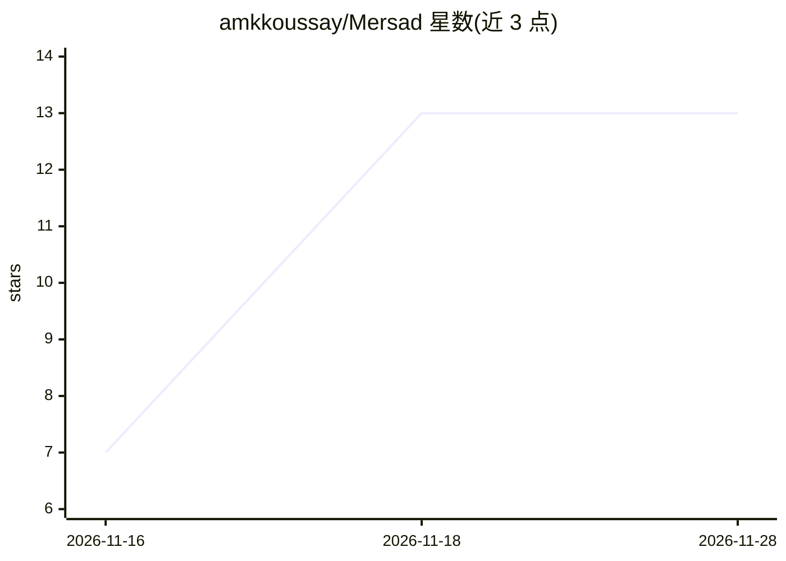

# amkkoussay/Mersad

⭐ 13 · Python · MIT · 推送 2026-11-24 · [GitHub](https://github.com/amkkoussay/Mersad) · 个人维护 · 中文 README

**给 AI agent 共享本地记忆库：双时态事实与决策日志**

基于 MCP 的开源共享记忆服务器，让 Claude、ChatGPT 等多个客户端读写同一份本地记忆：事实带有效期与记录时间（双时态、只作废不删除），决策作为一等单元存储原因、证据、被拒备选与结果，跨 agent 冲突进入队列由所有者裁决，另提供本地实时图视图。写入路径零 LLM 调用、零 API key，数据落在单个 SQLite 文件，可通过 Termux 在手机上运行。MIT 许可，Python 3.11+。

## 筛选速览

| 维度 | 判定 | 备注 |
|---|---|---|
| AI 角色 | `ai-ecosystem` | LLM/agent 周边工具 |
| 许可风险 | `permissive` | MIT |
| 部署形态 | `library` | 以包/库形式分发 |
| 模型依赖 | — | README 未给出锁定关系 |
| 硬件要求 | — | 无带数字的原话,不猜 |
| 安装摩擦 | `low` | 无编译、无系统依赖或容器化 |
| 成熟度 | — | 结构信号不足 |

## 能力要点

- 双时态事实：作废不删除，可查询过去任一时间点的真值
- 决策为一等单元，why 查询即可追溯原因与结果链
- 跨 agent 冲突队列由所有者裁决，不静默覆盖
- 单 SQLite 文件、写入路径无 LLM、本地实时图视图

## 适用场景

- 让多个 AI 助手共享同一份事实与决策记忆
- 审计某条决策是谁在何时基于什么证据做出的
- 需要本地优先、不依赖外部服务的 agent 记忆存储

## 场景标签

`Agent 记忆` · 领域:Agent 开发

## 证据(README 行号)

> L43: MIRSAD is an **open-source shared memory server for AI agents**, built on the
> L70: Install from PyPI: `pip install mirsad-mcp` — then point your MCP client

## 星数曲线

2026-11-16 7 → 2026-11-28 13（+6）

---
*卡片 v1 · prompt 1.4 · 生成 2026-11-18 · 置信度 high · 依据 README sha `760efbbd65ae` · [字段定义](../../DATASET.md)*
