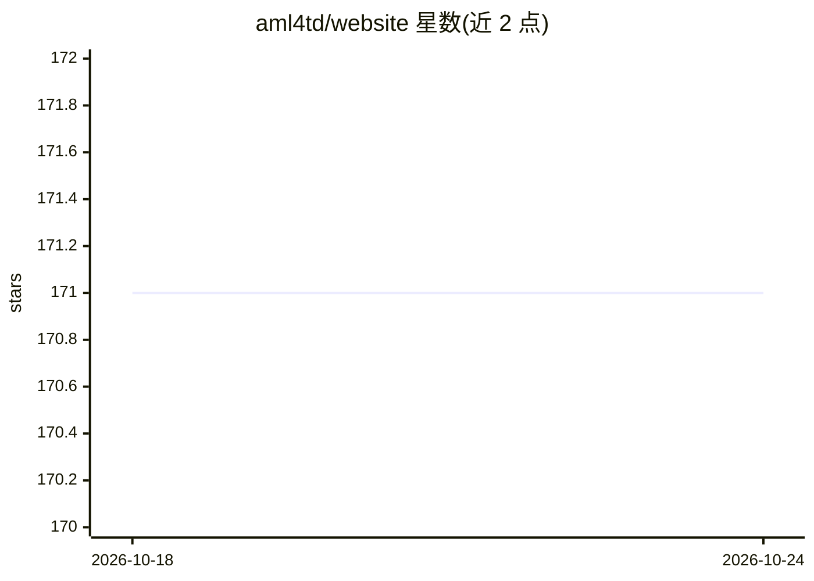

# aml4td/website

⭐ 171 · HTML · NOASSERTION · 推送 2026-10-23 · [GitHub](https://github.com/aml4td/website) · [官网](https://aml4td.org/) · 个人维护

**面向表格数据预测建模的开放教材（书稿源文件）**

《Applied Machine Learning for Tabular Data》一书的网站源码仓库，内容仍在撰写中，采用 Creative Commons 许可，计划完成后与出版伙伴合作推出纸质版。全书覆盖预测建模全流程，将特征工程与机器学习模型紧密结合，并详细讨论最终模型确定后的后建模活动。目标读者为数据分析师、统计学家、数据科学家及授课教师，不要求读者为方法专家。内容刻意与具体软件解耦，另以 tidymodels 计算补充材料（tidymodels.aml4td.org）与练习集（exercises.aml4td.org）配套提供，基于 Quarto（.qmd）编写，通过 GitHub PR 接受社区修订。

## 筛选速览

| 维度 | 判定 | 备注 |
|---|---|---|
| AI 角色 | `ai-knowledge` | 知识聚合/清单类 |
| 许可风险 | `none` | NOASSERTION |
| 部署形态 | `None` |  |
| 模型依赖 | — | README 未给出锁定关系 |
| 硬件要求 | — | 无带数字的原话,不猜 |
| 安装摩擦 | `low` | 无编译、无系统依赖或容器化 |
| 成熟度 | `idea` | |

## 能力要点

- 将特征工程方法与机器学习模型紧密耦合的全流程讲解
- 与软件解耦，配套 tidymodels 计算补充材料与在线练习集
- Creative Commons 许可，社区可通过 PR 贡献修订
- 覆盖选定最终模型之后的后建模活动

## 适用场景

- 系统学习表格数据预测建模的完整流程
- 寻找机器学习课程的教学材料或参考书
- 了解 tidymodels 框架下的建模实践（配套补充材料）

## 场景标签

`教程课程` · 领域:学习与行业

## 证据(README 行号)

> L3: Welcome! This is a work in progress. We want to create a practical guide to developing quality predictive models fro
> L9: The book takes a holistic view of the predictive modeling process and focuses on a few areas that are usually left o
> L24: Our intended audience includes data analysts of many types: statisticians, data scientists, professors and instruct

## 星数曲线

2026-10-18 171 → 2026-10-24 171（+0）

---
*卡片 v1 · prompt 1.4 · 生成 2026-10-22 · 置信度 high · 依据 README sha `529c97b9ccae` · [字段定义](../../DATASET.md)*
