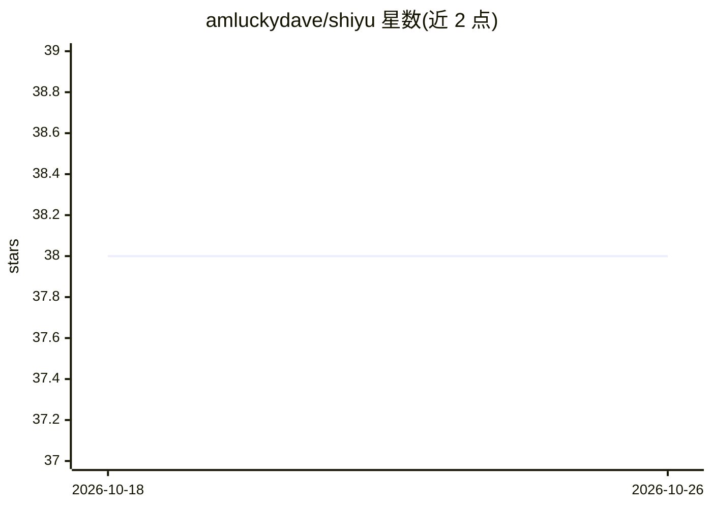

# amluckydave/shiyu

⭐ 38 · Vue · MIT · 推送 2026-03-20 · [GitHub](https://github.com/amluckydave/shiyu) · [官网](https://amluckydave.github.io/shiyu/) · 个人维护 · 中文 README

**英语学习桌面应用：AI 划词翻译标注与 FSRS 间隔复习**

基于 Tauri 2 + Vue 3 + Rust 的开源英语学习桌面应用，面向外刊精读与原版书阅读场景。提供 Markdown 沉浸阅读与划词标注、流式 AI 翻译与句子成分标注、AI 思维导图、基于 FSRS 算法的生词/句子闪卡复习、EPUB 按章节导入、PP-StructureV3 OCR 识别导入、TTS 朗读等功能。数据全部存储于本地 SQLite，需用户自行配置 DeepSeek/OpenAI 兼容 API Key 后使用 AI 功能。构建需 Node.js 18+/pnpm、Rust toolchain 与 Tauri 平台依赖。

## 筛选速览

| 维度 | 判定 | 备注 |
|---|---|---|
| AI 角色 | `ai-enhanced` | 去掉 AI 部分产品仍成立 |
| 许可风险 | `permissive` | MIT |
| 部署形态 | `library` | 以包/库形式分发 |
| 模型依赖 | locked-api |  |
| 硬件要求 | — | 无带数字的原话,不猜 |
| 安装摩擦 | `low` | 无编译、无系统依赖或容器化 |
| 成熟度 | — | 结构信号不足 |

## 能力要点

- 流式 AI 翻译与句子成分彩色标注，兼容 DeepSeek/OpenAI 接口
- FSRS 算法间隔复习闪卡（4 级评分）
- EPUB 按章节导入与 PP-StructureV3 OCR 识别导入
- 数据全部本地存储（SQLite），JSON 导入/导出

## 适用场景

- 外刊精读时划词查生词并做高亮标注
- 原版书阅读中让 AI 拆解长难句、生成思维导图
- 用 FSRS 闪卡间隔复习积累的生词和句子

## 场景标签

`语音合成` `OCR` · 领域:内容生成

## 证据(README 行号)

> L14: 拾语是一款开源的英语学习桌面应用，集成 AI 翻译、文章阅读标注、生词/句子管理、SRS 间隔复习、思维导图、OCR 导入、EPUB 提取等功能。
> L28: |🔄 **SRS 间隔复习**|FSRS 算法闪卡，4 级评分，键盘快捷键|
> L31: |📷 **OCR 导入**|PP-StructureV3 识别 + AI 校正，一键导入|

## 星数曲线

2026-10-18 38 → 2026-10-26 38（+0）

---
*卡片 v1 · prompt 1.4 · 生成 2026-10-25 · 置信度 mid · 依据 README sha `0b37c4ec3950` · [字段定义](../../DATASET.md)*
