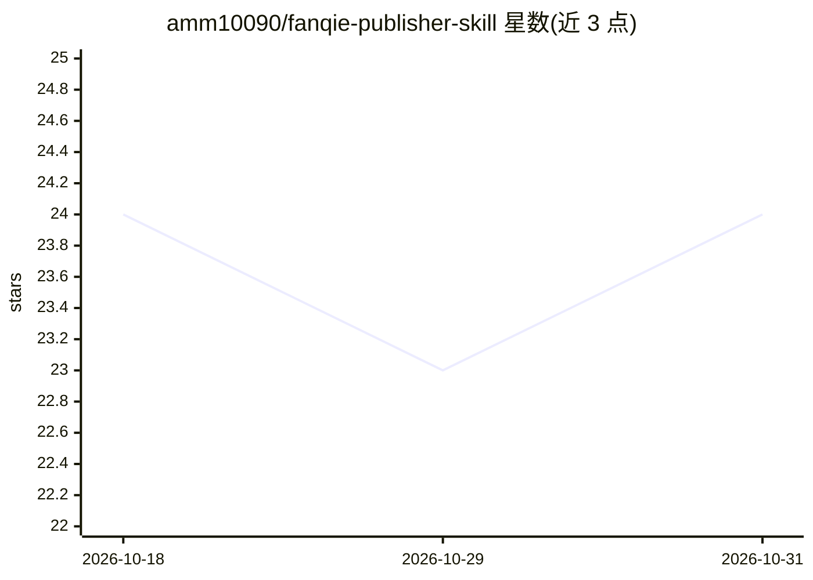

# amm10090/fanqie-publisher-skill

⭐ 24 · JavaScript · MIT · 推送 2026-10-25 · [GitHub](https://github.com/amm10090/fanqie-publisher-skill) · [官网](https://github.com/amm10090/fanqie-publisher-skill#readme) · 个人维护 · 中文 README

**AI Agent 用的番茄小说章节自动发布技能（Playwright）**

面向已备好章节文件的作者及协助操作后台的 AI Agent：通过 Playwright 经 CDP 连接本地 Chromium/Chrome，将本地 Markdown 章节填入番茄小说作者后台，支持预览、仅填充、到达最终弹窗等分阶段核对模式，真实发布需 --confirm-publish 与用户当轮授权。填充后逐字符回读比对中文、Emoji 与换行，支持批量、定时与字符数保护阈值，本地 state/ 保存登录态、截图与章节记录。提供 OpenClaw/Hermes Agent、Claude Code、Codex CLI、Cline 的接入入口。限制：目标作品写死在源码，需自行启动浏览器并扫码登录，需 Node.js、Python 3 与可 CDP 连接的浏览器。

## 筛选速览

| 维度 | 判定 | 备注 |
|---|---|---|
| AI 角色 | `ai-ecosystem` | LLM/agent 周边工具 |
| 许可风险 | `permissive` | MIT |
| 部署形态 | `library` | 以包/库形式分发 |
| 模型依赖 | — | README 未给出锁定关系 |
| 硬件要求 | — | 无带数字的原话,不猜 |
| 安装摩擦 | `low` | 无编译、无系统依赖或容器化 |
| 成熟度 | — | 结构信号不足 |

## 能力要点

- Playwright 经 CDP 操作番茄后台，分阶段（预览/仅填充/最终弹窗/确认发布）核对
- 填充后正文逐字符回读比对，不一致即中止该章
- 支持批量、番茄后台原生定时发布与每日字符数保护阈值
- 提供 OpenClaw/Hermes Agent/Claude Code/Codex CLI/Cline 接入入口

## 适用场景

- 网文作者把本地 Markdown 章节批量填入番茄作者后台
- 让 AI Agent 代为操作后台并在确认后完成章节发布
- 按分卷、定时排期发布连载章节

## 场景标签

`浏览器自动化` · 领域:效率与自动化

## 证据(README 行号)

> L5: 面向已经准备好章节文件的作者，以及协助作者操作后台的 AI Agent。项目通过 Playwright 将本地 Markdown 章节填入番茄小说作者后台，核对后再发布，入口统一为 `scripts/publish_fanqie.j
> L204: |使用环境|入口|
> L206: |OpenClaw / Hermes Agent|`SKILL.md` 技能定义|

## 星数曲线

2026-10-18 24 → 2026-10-31 24（+0）

---
*卡片 v1 · prompt 1.4 · 生成 2026-10-27 · 置信度 high · 依据 README sha `06a23383ffc5` · [字段定义](../../DATASET.md)*
