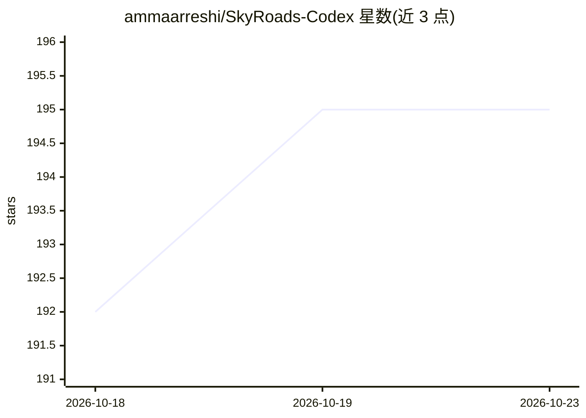

# ammaarreshi/SkyRoads-Codex

⭐ 195 · Rust · 推送 2026-03-08 · [GitHub](https://github.com/ammaarreshi/SkyRoads-Codex) · 个人维护

**用 Codex 辅助逆向 DOS 游戏 SkyRoads 并用 Rust 原生重制**

对 1993 年 DOS 游戏 SkyRoads 的逆向工程与原生移植项目：反汇编原版可执行文件，解析 .LZS 资源格式、TREKDAT 渲染数据、DEMO.REC 等格式，用 Rust 重建确定性玩法、参考渲染器、音频路径与 SDL 宿主，运行于 macOS 等现代平台，并以对照 DOS 二进制的方式验证行为。开发过程借助 Codex（描述中注明 Codex 5.4），已可玩但未达到 1:1。运行需 Rust 工具链与系统 SDL2。

## 筛选速览

| 维度 | 判定 | 备注 |
|---|---|---|
| AI 角色 | `ai-enhanced` | 去掉 AI 部分产品仍成立 |
| 许可风险 | `none` | — |
| 部署形态 | `desktop` | 安装包/桌面程序 |
| 模型依赖 | — | README 未给出锁定关系 |
| 硬件要求 | — | 无带数字的原话,不猜 |
| 安装摩擦 | `low` | 无编译、无系统依赖或容器化 |
| 成熟度 | `idea` | |

## 能力要点

- 原生解析 .LZS/TREKDAT/DEMO.REC 等 SkyRoads 数据格式
- Rust 工作区含 data/core/renderer/audio/sdl/cli 六个 crate
- 提供 DOSBox-X 跟踪与调试 oracle 的 Python 验证工具
- intro/menu/demo/gameplay 流程已在原生 SDL 宿主中可运行

## 适用场景

- 在现代平台上原生运行 SkyRoads 并复现原版行为
- 研究 DOS 游戏资源格式与渲染管线的逆向过程
- 验证原生实现与 DOS 二进制的帧级/音频级一致性

## 场景标签

`编码 Agent` · 领域:编码与开发

## 证据(README 行号)

> L5: The goal is not to make a loose remake. The goal is a **true, deterministic port** that reproduces the shipped DOS b
> L16: - rebuilding those systems natively in Rust

## 星数曲线

2026-10-18 192 → 2026-10-23 195（+3）

---
*卡片 v1 · prompt 1.4 · 生成 2026-10-22 · 置信度 mid · 依据 README sha `897169109c6c` · [字段定义](../../DATASET.md)*
